# Updated Aerodynamic Database

## Status

"Valid"

"Revision History: None"

"Replacement Log: Replaces [0002-Preliminary-Design-Aerodynamic-Database](../0002-Preliminary-Design-Aerodynamic-Database/information-note.md)"

"Reference: [0002-Preliminary-Design-Aerodynamic-Database](../0002-Preliminary-Design-Aerodynamic-Database/information-note.md)"

## Project Description

This information note documents the updated aerodynamic database generation work for Project Spearhead. The database replaces the preliminary design aerodynamic database. The purpose of the database is to provide force, moment, and coefficient data over the aircraft angle-of-attack and sideslip envelope, together with the aileron, elevator and rudder effects, so that the results can be used for flight dynamics modelling, control simulation, and later flight-control table generation.

A new CFD simulation file with deflectable control surfaces and the pusher actuator disk was used for all analyses, so the propeller effect is included directly and no separate actuator disk correction is needed. [SakeDB](https://github.com/Arrow-air/project-spearhead/blob/main/src/tools/SakeDB/README.md) was used to define and manage a 400-case CFD campaign with neutral control surfaces, and a surrogate surface was generated from it. With the same simulation file, 113 control surface deflection cases were solved with a script. Finally, the dense surrogate output was processed with [Nondimit](https://github.com/Arrow-air/project-spearhead/blob/main/src/tools/Nondimit/README.md) for coefficient-table preparation, drag correction for omitted components, and sign-convention checks.

This note does not describe the internal operation of SakeDB or Nondimit. It records how the tools were used in the aerodynamic database workflow and what was delivered.

## Methodology

### 1. CFD Run Methodology

Each database point was solved as a steady CFD case, with the same simulation setup for the database and for every deflection case. The analyses used a segregated flow solver with an ideal gas model and the SST K-Omega turbulence model. All Y+ wall treatment was used with five boundary-layer prism layers, a 1 mm near-wall layer and 8 mm total thickness. The computational mesh used approximately 2.9 million polyhedral cells.

Each analysis was run for 400 iterations, except the first five database cases at alpha -90 deg, which were run for 500 iterations.

The simulation file has one deflection parameter for each control: aileron, elevator and rudder. The left and right ruddervators are driven by the mixed elevator and rudder commands. The pusher propeller is modelled with a blade element virtual disk trimmed to a target thrust of 30 N at 4300 rpm in every analysis, so the slipstream effect is included in the airframe loads. The force of the disk itself is not part of the delivered loads.

Every analysis reports the body-axis forces and moments "Fx", "Fy", "Fz", "Mx", "My", and "Mz" about the CFD origin (0 m, 0 m, 0 m).

| Figure | | |
|--------|---|---|
| Volume mesh, symmetry plane, and convergence plot | 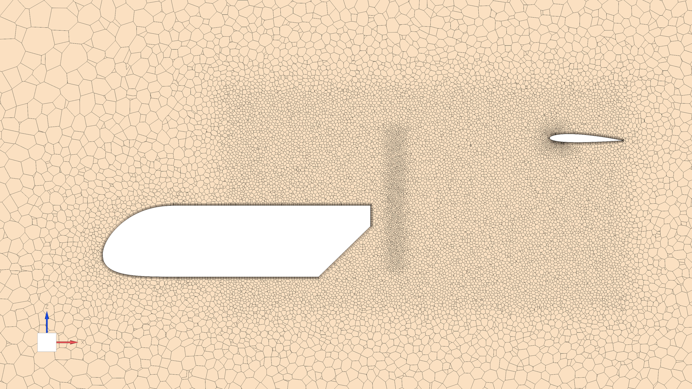 | 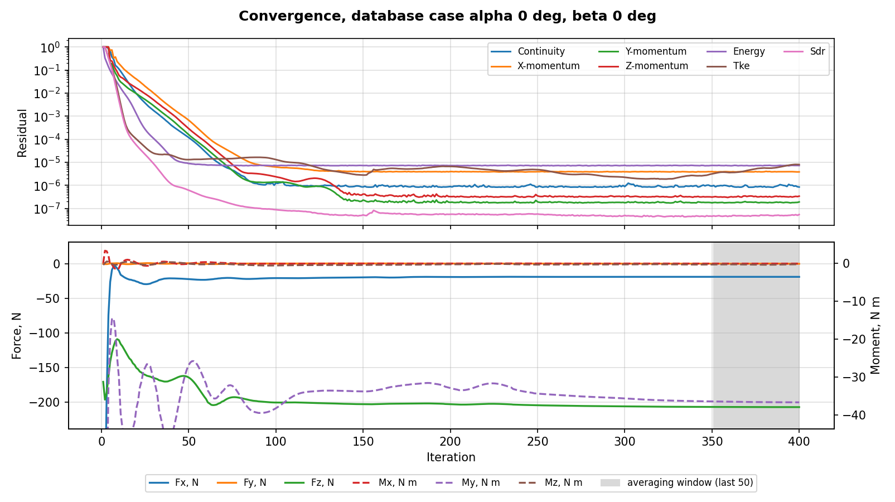 |
| Deflected aileron, surface and volume mesh | 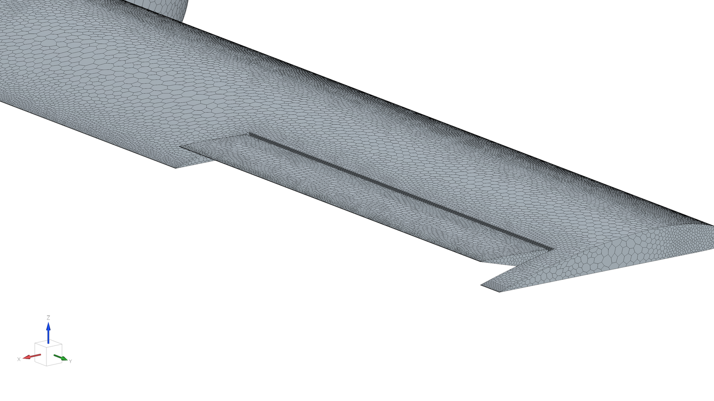 | 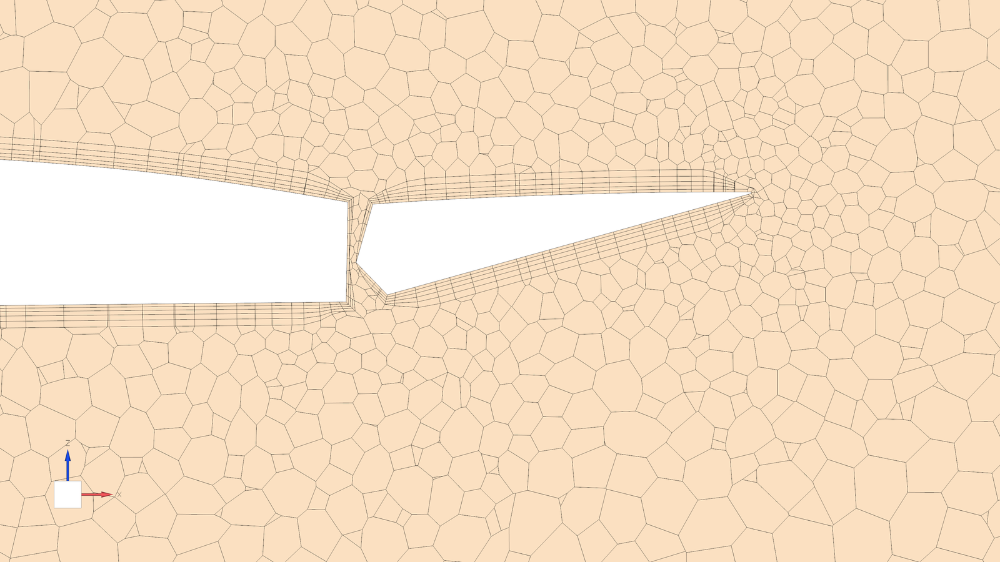 |
| Deflected ruddervator, surface and volume mesh | 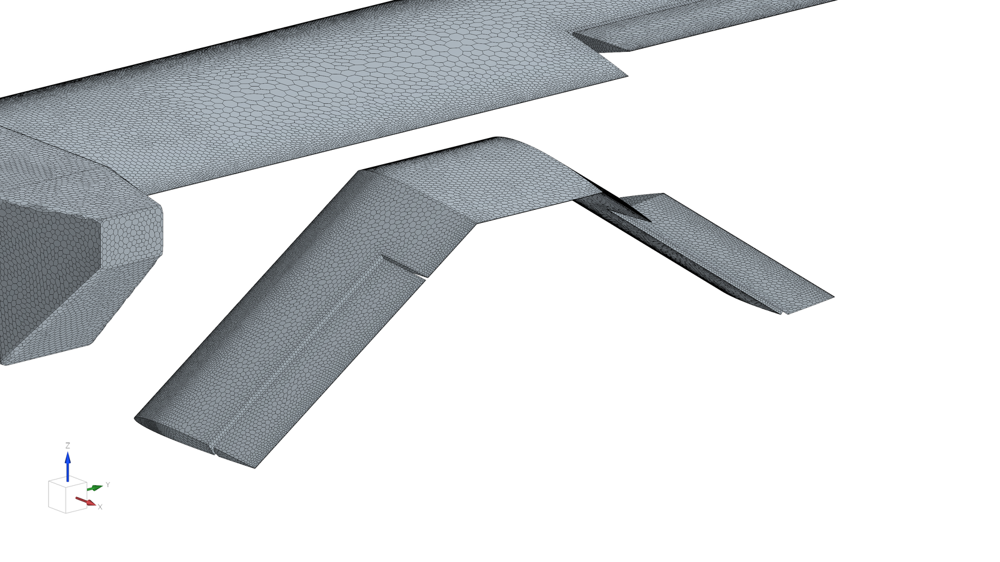 | 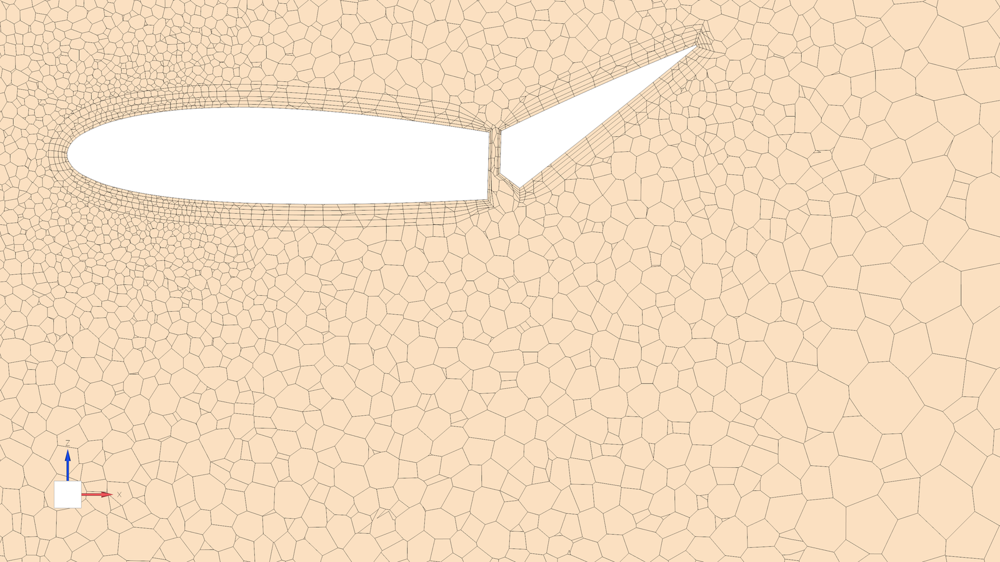 |

The deflected views are at aileron +15 deg, elevator -15 deg and rudder +15 deg.

### 2. Aerodynamic Database Campaign

The aerodynamic database was generated with all control surfaces at 0 deg. This database includes 400 CFD analyses over alpha from -90 deg to +90 deg and beta from 0 deg to +90 deg.

The campaign started with 30 Latin hypercube points and 144 anchor points on a fixed alpha-beta grid. The remaining 226 points were placed one at a time where the surrogate uncertainty and curvature were highest, with extra weight around cruise (alpha 3 deg) and stall (alpha 16 deg). Each analysis was averaged over the last 50 iterations, except the first five cases, which were averaged over the last 20.

Compared with the preliminary design aerodynamic database, the actuator disk is part of every analysis, so the database is built from one campaign instead of an 800-case surface corrected with an 80-case actuator disk database.

### 3. Surrogate Surface Generation

After the 400-case database was completed, a surrogate surface was generated from these results. The negative-sideslip half was obtained from symmetry: "Fy", "Mx", and "Mz" are odd functions of beta, and the other outputs are even.

The delivered dense grid covers alpha from -90 deg to +90 deg and beta from -90 deg to +90 deg at 1 deg increments, for 181 x 181 points and 32,761 total rows.

### 4. Control Surface Deflection Cases

The control surface effects were solved as separate cases with a script. For each case, the script set the alpha, beta, velocity and control deflections, remeshed the deflected geometry and solved the case with the same solver setup. Each case was averaged over the last 50 iterations, and every control case has a neutral reference case at the same alpha, beta and velocity.

The 113 cases were run in three batches. The first batch covers +/-5 deg single-surface deflections at 25 m/s from alpha -5 deg to 30 deg, with elevator cases at 10 m/s and 15 m/s. The second batch covers the full command travel of elevator and rudder +/-15 deg and aileron +/-30 deg, and combined elevator and rudder commands. The third batch extends the elevator to -20 deg and -30 deg at 22 m/s, beyond the +/-15 deg command limit, at the request of the flight dynamics team to show whether the elevator saturates. The full case matrix is given in [Case Matrix](assets/case_matrix.md).

The deflection cases are delivered as direct CFD results, with the same mesh settings as the aerodynamic database, as dimensional loads about the CFD origin, without a surrogate, drag multiplier or other correction.

### 5. Coefficient Output Preparation

The dense surrogate output was then processed with Nondimit in the same way as the preliminary design aerodynamic database, with three differences. The moment reference center is the CG used for this campaign, (-0.10 m, 0 m, 0.15 m), instead of (-0.15 m, 0 m, 0.15 m). The reference density is the run condition of the new simulation file, 1.021 kg/m^3, instead of 1.09 kg/m^3. "Fy", "Mx", and "Mz" are set to zero at beta = 0 deg to remove the small asymmetry left by the surrogate.

The wind-frame drag multiplier of 1.3 for omitted drag-producing components was applied as in the preliminary design aerodynamic database, to the wind-frame drag component "D" only, and the corrected drag vector was projected back into body axes.

## Results and Deliverables

### Database Package

The database package provides the aerodynamic database as the main deliverable, and the control table with the deflection cases as a supporting deliverable. The control table is split in two files because the third batch was run later.

| Deliverable | Description |
|-------------|-------------|
| [Aerodynamic database](assets/database.csv) | Dense surrogate table converted into body and wind-frame aerodynamic coefficients with Nondimit, after the 1.3x drag multiplier |
| [Control table](assets/deflection.csv) | Case001 to Case103: case inputs (alpha, beta, velocity, aileron, elevator, rudder) and the six dimensional loads about the CFD origin |
| [Control table, 22 m/s elevator extension](assets/deflection_cases_104_113.csv) | Case104 to Case113, same format |

The aerodynamic database file starts with a three-line Nondimit header that lists the reference values, the moment reference center and the export options. If another reference value set, moment reference center or correction setup is required, users can regenerate the database export with Nondimit. Note that the delivered coefficient table is referenced to the aircraft CG at (-0.10 m, 0 m, 0.15 m), while the control table is referenced to the CFD origin (0 m, 0 m, 0 m).

| Drag | Lift |
|-------|------|
| 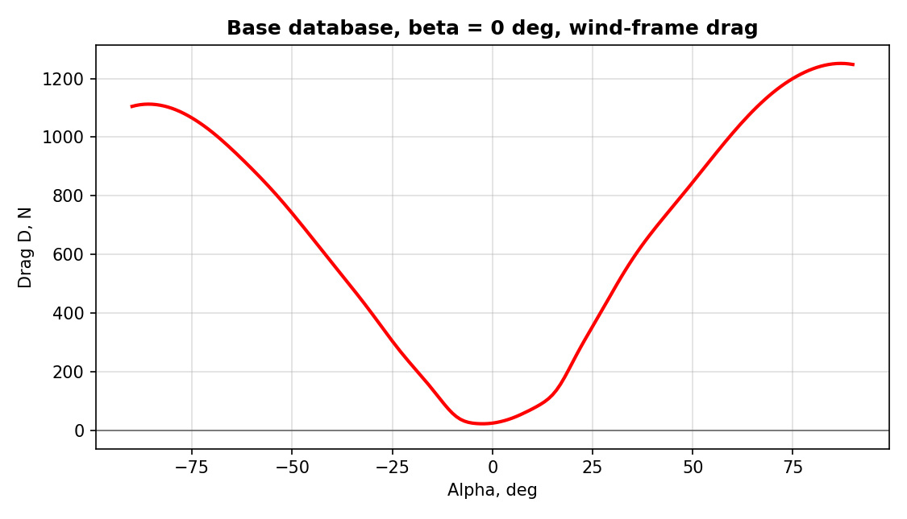 | 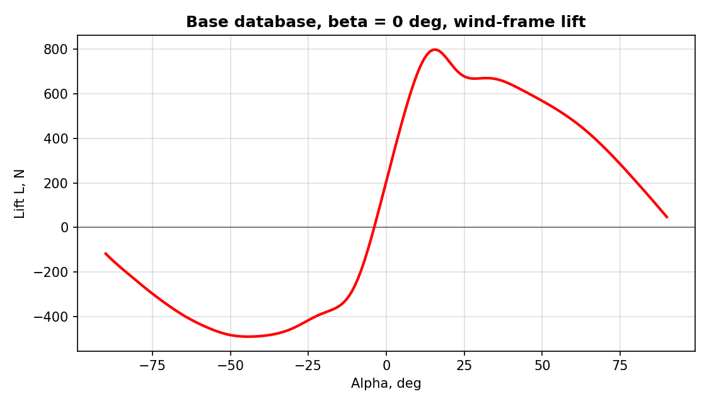 |
| 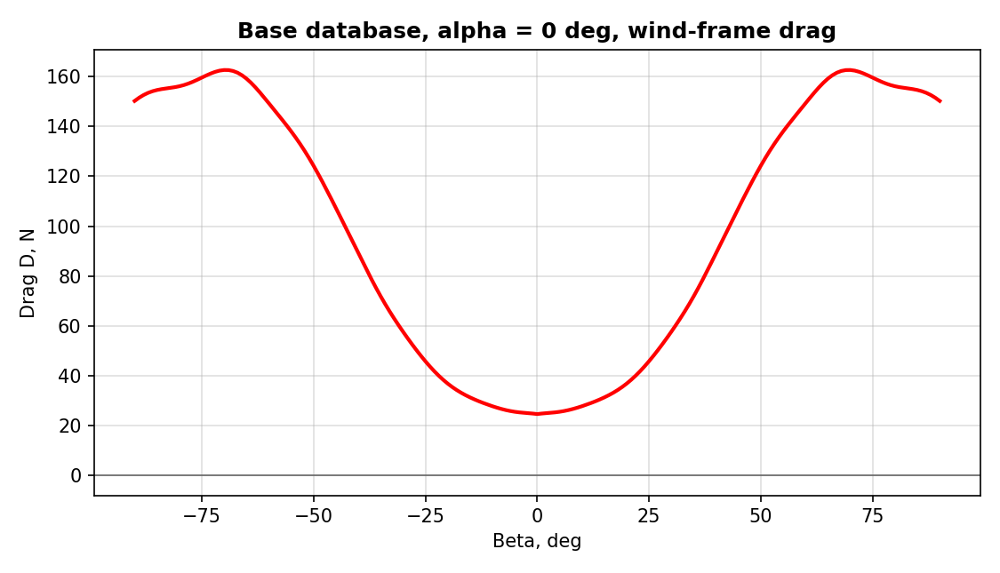 | 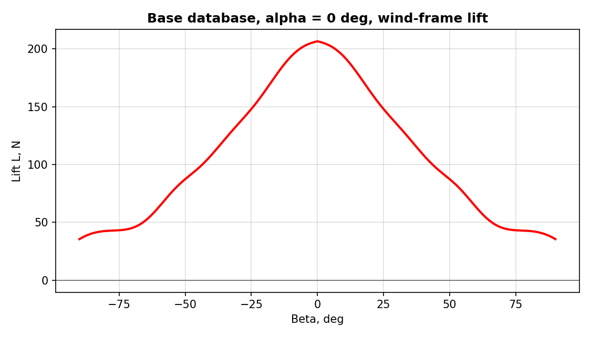 |

### Control Surface Increments

The control increments at full command, taken from the neutral case Case008 at 25 m/s, alpha 0 deg and beta 0 deg, about the CFD origin, are:

| Case | Command | dFx, N | dFy, N | dFz, N | dMx, N m | dMy, N m | dMz, N m |
|------|---------|-------:|-------:|-------:|---------:|---------:|---------:|
| Case074 | Elevator -15 deg | -2.14 | 0.05 | 21.25 | 0.00 | 29.93 | 0.14 |
| Case075 | Elevator +15 deg | -3.98 | -0.01 | -24.39 | 0.02 | -27.96 | 0.19 |
| Case086 | Rudder -15 deg | -3.47 | 11.76 | -1.50 | -4.74 | 0.38 | -15.75 |
| Case087 | Rudder +15 deg | -7.92 | -12.45 | -2.15 | 4.88 | 2.96 | 17.29 |
| Case092 | Aileron -15 deg | -8.60 | 1.27 | 15.03 | -124.35 | 2.14 | 8.03 |
| Case093 | Aileron +15 deg | -8.36 | -1.16 | 14.43 | 124.40 | 2.21 | -7.93 |
| Case094 | Aileron -30 deg | -26.10 | 1.97 | 28.77 | -238.99 | 3.97 | 11.09 |
| Case095 | Aileron +30 deg | -26.02 | -1.90 | 28.80 | 238.72 | 4.15 | -10.69 |

A negative elevator (trailing edge up) gives a nose-up pitching moment. A positive rudder gives a nose-right yawing moment with a negative side force. A positive aileron gives a positive rolling moment with adverse yaw. The responses to opposite commands are close to antisymmetric.

At 22 m/s, the elevator pitching moment stays linear down to -20 deg, at about 1.5 N m/deg, and does not saturate down to -30 deg. At -30 deg no rudder authority is left on the ruddervators, so the elevator command limit stays at +/-15 deg.

| Elevator | Elevator at 22 m/s |
|----------|--------------------|
| 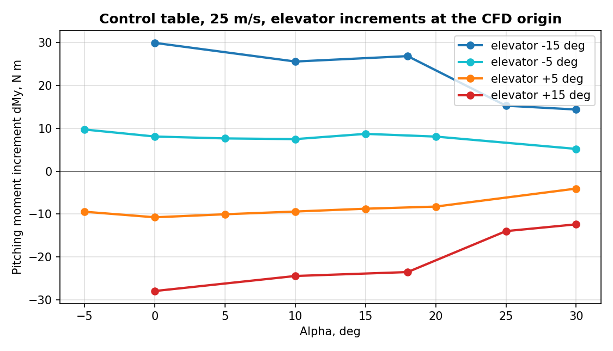 | 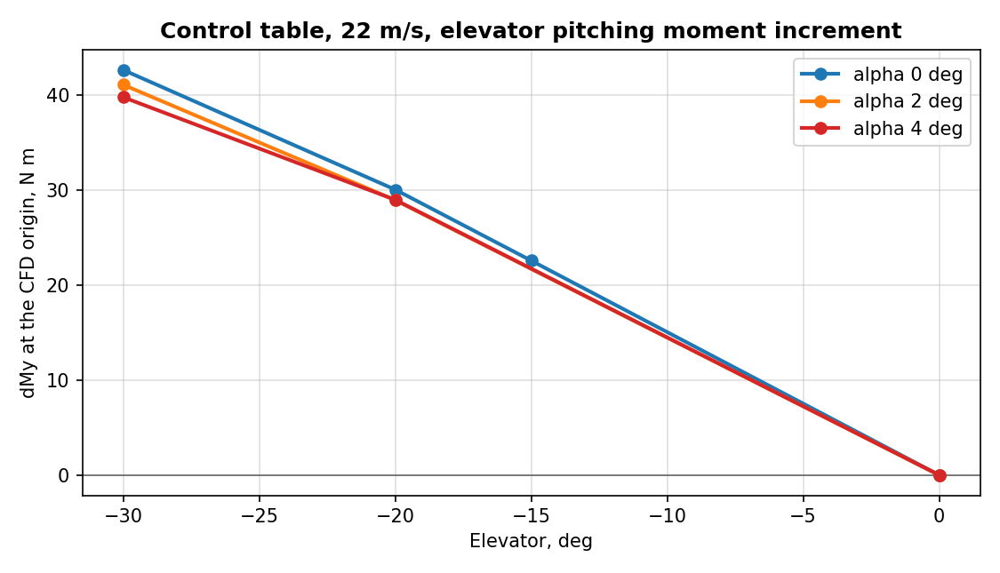 |
| **Aileron** | **Rudder** |
| 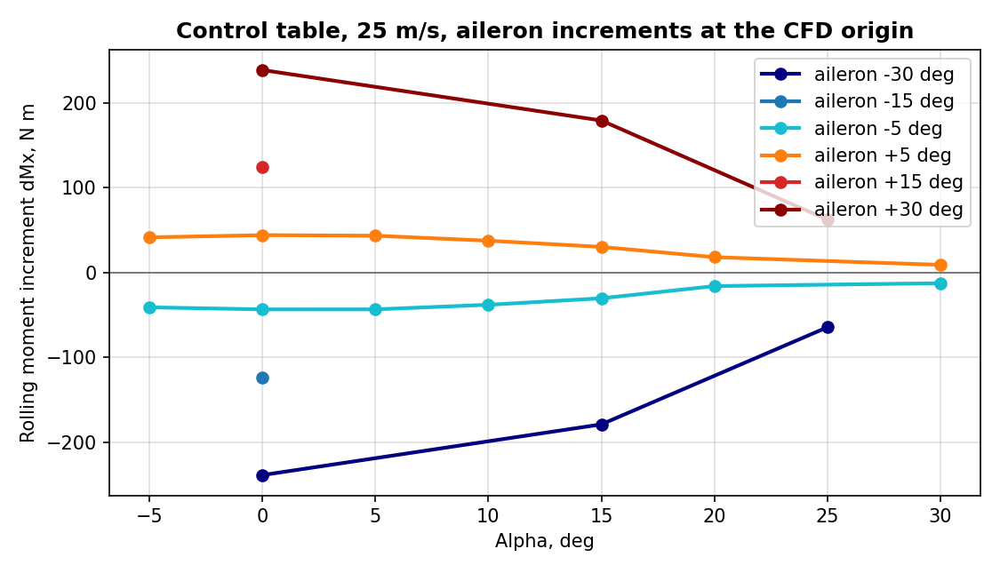 | 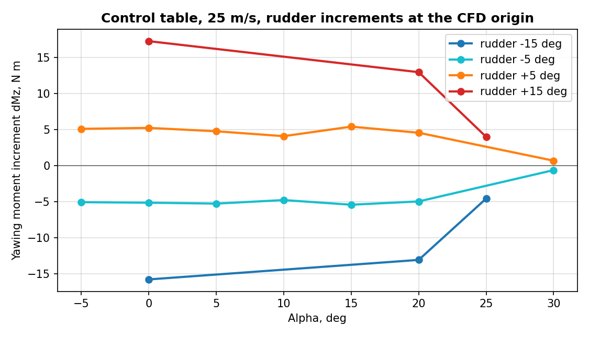 |

### How to Use the Database

For preliminary design, flight-dynamics modelling, and control-table preparation, it is recommended to use the **Aerodynamic database** as the main aerodynamic database, in place of the preliminary design aerodynamic database. The 1.3x wind-frame drag multiplier was applied to cover known drag-producing equipment and installation details that were omitted from the CFD geometry. Where control effects are needed, the control increments from the **Control table** are added to it as described below.

The coefficient table is organized by alpha and beta in degrees. The delivered coefficient grid covers alpha from -90 deg to +90 deg and beta from -90 deg to +90 deg at 1 deg increments, for 32,761 total rows. Users should interpolate within the provided alpha-beta grid and avoid extrapolating outside this range. The coefficient columns are dimensionless and should be dimensionalized using the reference values below.

| Reference | Symbol | Value |
|-----------|--------|-------|
| Air density | $$\rho$$ | 1.021 kg/m^3 |
| Reference velocity | $$V$$ | 25 m/s |
| Dynamic pressure | $$q = 0.5 \rho V^{2}$$ | 319.0625 Pa |
| Reference area | $$S$$ | 1.805 m^2 |
| Reference span | $$b$$ | 3.95 m |
| Reference chord | $$c$$ | 0.457 m |
| Force denominator | $$qS$$ | 575.9078 N |
| Roll and yaw moment denominator | $$qSb$$ | 2274.8358 N m |
| Pitch moment denominator | $$qSc$$ | 263.1899 N m |
| Moment reference center / CG, body x y z | $$(x_m, y_m, z_m)$$ | -0.10 m, 0 m, 0.15 m |

The density value corresponds to the run condition of the simulation file.

The dynamic pressure and denominators are:

$$
q = \frac{1}{2} \rho V^{2}
$$

Wind-frame forces are dimensionalized as:

$$
D = C_D qS
$$

$$
S_w = C_S qS
$$

$$
L = C_L qS
$$

Body-axis forces are dimensionalized as:

$$
F_x = C_{F_x} qS
$$

$$
F_y = C_{F_y} qS
$$

$$
F_z = C_{F_z} qS
$$

Body-axis moments are dimensionalized as:

$$
M_x = C_{M_x} qSb
$$

$$
M_y = C_{M_y} qSc
$$

$$
M_z = C_{M_z} qSb
$$

Wind-frame moments are dimensionalized as:

$$
R = C_R qSb
$$

$$
M = C_M qSc
$$

$$
N = C_N qSb
$$

The corresponding coefficient columns in the delivered CSV are **cd**, **cs**, **cl**, **cfx**, **cfy**, **cfz**, **cmx**, **cmy**, **cmz**, **cr**, **cm**, and **cn**. The dimensional loads are also given in the columns **Fx**, **Fy**, **Fz**, **Mx**, **My**, **Mz**, **D**, **S**, **L**, **R**, **M**, and **N**.

| Reference frame notation |
|--------------------------|
| 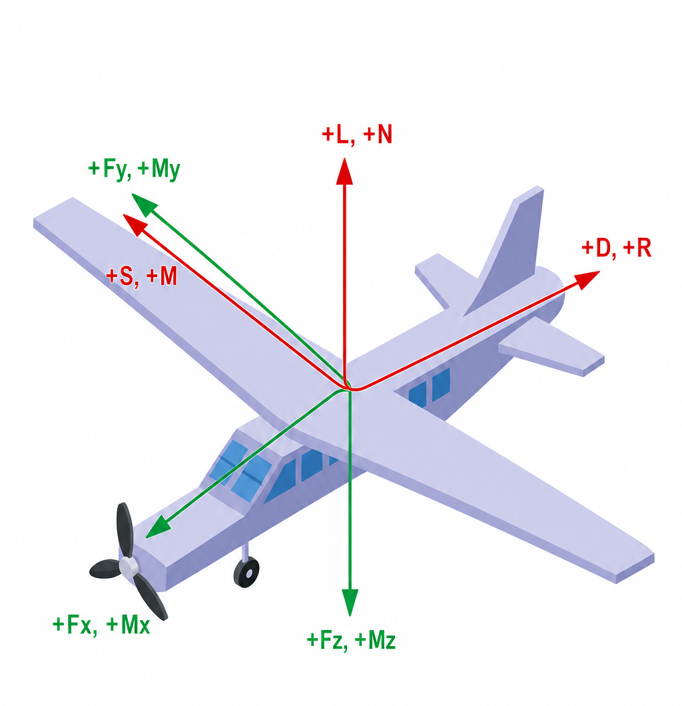 |

Body-axis outputs should be used when the receiving flight-dynamics model expects aircraft body axes. The body-axis convention is x forward, y right, and z down. Wind-frame outputs should be used for aerodynamic review and sign-convention checks. In the wind-frame convention used here, drag is positive aft along the wind direction, lift is positive upward, and side force is positive to the right.

A control increment is taken from a control case minus its own neutral reference case at the same alpha, beta and velocity:

$$
\Delta F = F_{case} - F_{neutral}
$$

$$
\Delta M_{0} = M_{case} - M_{neutral}
$$

The increments are about the CFD origin. Before they are added to the aerodynamic database, the moment increments must be moved to the moment reference center $$\mathbf{r} = (x_m, y_m, z_m)$$:

$$
\Delta \mathbf{M}_{ref} = \Delta \mathbf{M}_{0} - \mathbf{r} \times \Delta \mathbf{F}
$$

The control table cases at 10, 15 and 22 m/s are dimensional loads at their own velocity and should be scaled by dynamic pressure before they are compared with the 25 m/s cases. The two tables differ as follows:

| Item | Aerodynamic database | Control table |
|------|----------------------|---------------|
| Moment reference center | (-0.10 m, 0 m, 0.15 m) | (0 m, 0 m, 0 m) |
| Content | Coefficients and dimensional loads | Dimensional loads only |
| Drag correction | 1.3x wind-frame drag multiplier | None |
| Beta = 0 cleanup | "Fy", "Mx", "Mz" zeroed | None |
| Values | Surrogate surface | Direct CFD results |

If a different moment reference center, reference area, span, chord, density, or velocity is required, the table should be regenerated with Nondimit instead of manually editing the moment coefficient columns.

## Remarks

- The 400-iteration runs with last-50 averaging are accepted for the current aerodynamic database stage. The achieved disk thrust is 27 N to 30 N against the 30 N target.
- With the CG at x = -0.10 m, the aircraft is not statically stable in pitch by itself. The estimated neutral point is x = -0.051 m to -0.072 m, and the longitudinal stability analysis will define the allowable CG range.
- The control surface effects are delivered as separate CFD cases and are not merged into the coefficient table. They are added to the coefficient table as described in How to Use the Database.
