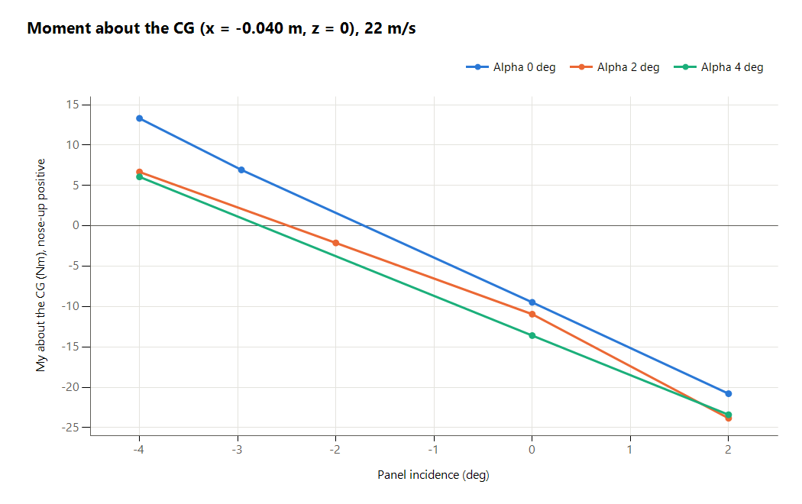
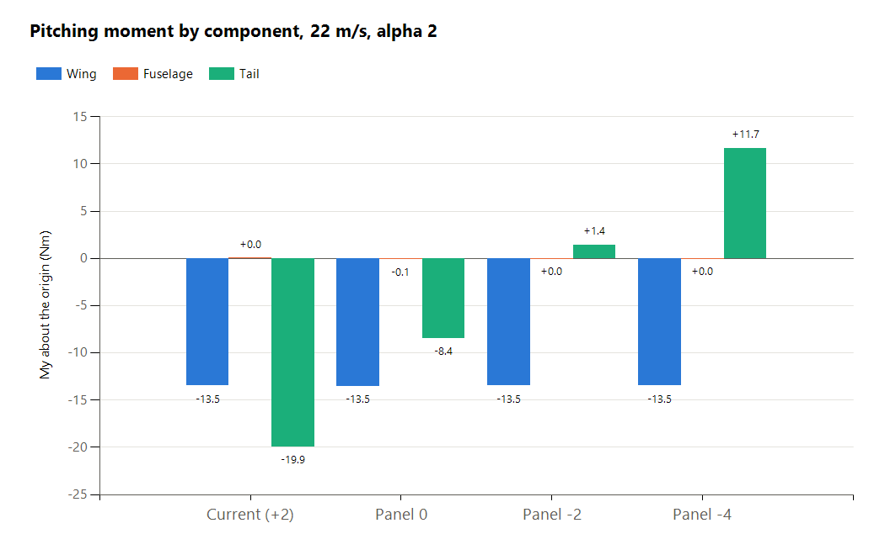

# Tail Incidence and Elevator Trim Study

## Status

"Valid"

"Revision History: None"

"Replacement Log: None"

"Reference: [0003 Updated Aerodynamic Database](../0003-Updated-Aerodynamic-Database/information-note.md)"

## Project Description

This note delivers the tail-incidence CFD case results and summarizes their effect on elevator trim. The study compares the current +2 deg tail with 0, -2 and -4 deg settings, mainly at 22 m/s and the 25 m/s cruise, with additional cases at 17 and 28 m/s.

## Methodology

### 1. Incidence and Case Coverage

Incidence is the airfoil angle of each inclined V-tail panel, measured in a section perpendicular to its span, positive with the leading edge up.

| Speed (m/s) | Neutral-elevator cases |
| --- | --- |
| 22 | Current, 0 and -4 deg at alpha 0, 2 and 4 deg; -2 deg at alpha 2 deg |
| 25 | 0 and -2 deg at alpha 0 and 2 deg; -4 deg at alpha 0, 2 and 4 deg; current-tail database cases plus alpha 1 deg |
| 17 | Current and -4 deg at alpha 4 and 6 deg |
| 28 | Current and -4 deg at alpha -1 and 0 deg |

Additional cases cover elevator deflection and beta = 5 deg.

### 2. CFD Setup and Outputs

The study uses the setup from note 0003, with approximately 2.92 million cells and an actuator disk targeting 30 N at 4300 rpm. Reported surface loads include the propeller slipstream effect.

Cases run for 400 iterations, with selected repeats at 800. Total loads use the last 150 or 200 iterations respectively; component loads use the last 50. Comparisons use the longer repeat where available.

Loads use body axes, x forward and z down, about the wing quarter-chord origin. Negative Fz is upward force; positive My is nose-up. Negative elevator is trailing edge up.

## Results and Deliverables

### Case Results

The [full case results](assets/results.csv) contain case inputs, total forces and moments, component loads, averaging windows and achieved disk thrust.

At 22 m/s, alpha = 2 deg and neutral elevator:

| Panel incidence (deg) | Total Fz (N) | My about origin (N m) | Tail Fz (N) |
| --- | ---: | ---: | ---: |
| +2, current | -239.03 | -33.39 | -15.18 |
| 0 | -229.13 | -20.11 | -6.36 |
| -2 | -220.65 | -10.94 | +1.29 |
| -4 | -212.21 | -1.82 | +9.29 |

Reducing incidence from +2 to -4 deg adds 31.57 N m of nose-up moment. This is **5.26 N m per degree of incidence reduction**, equivalent to about **3.6 to 4.4 deg of negative elevator** at this condition. The range reflects elevator effectiveness of 1.47 N m/deg on the -4 deg tail and 1.20 N m/deg from the current tail's single -5 deg case.

*Neutral elevator; CG x = -0.040 m, z = 0. Points are CFD results.*

The wing contributes about -13.5 N m across the settings. The current tail adds about -19.9 N m, which the elevator must counter. Lower incidence shifts the tail load downward while leaving the wing moment nearly unchanged.

*Component moments about the origin, with neutral elevator.*

### Trim Summary

Neutral-elevator trim is estimated around -2 to -2.5 deg panel incidence at 22 to 25 m/s, for 25 kg and CG (-0.040, 0, 0) m.

## Remarks

- At 17 m/s, the aircraft is expected to be transitioning toward the 25 m/s cruise speed. The actuator disk is therefore kept at 30 N to represent thrust above drag during acceleration.
- Pitching moment varies during the runs; the -4 deg baseline at 22 m/s, alpha 2 deg changed by about 2.6 N m in its longer repeat. Small differences should be read with this scatter in mind.
- The final incidence setting and aerodynamic database update remain to be confirmed.
