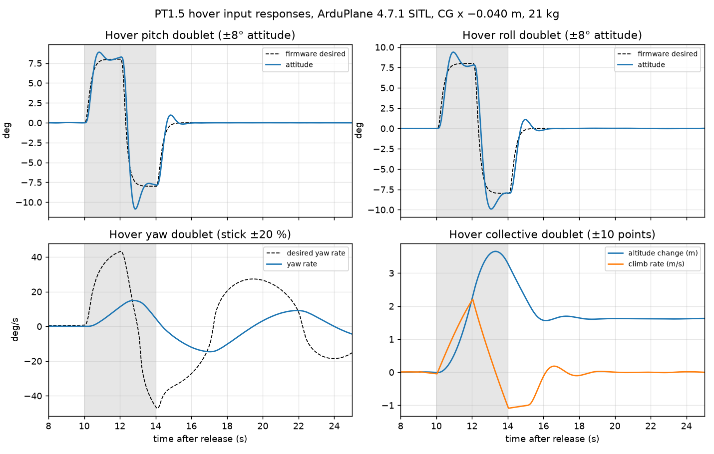
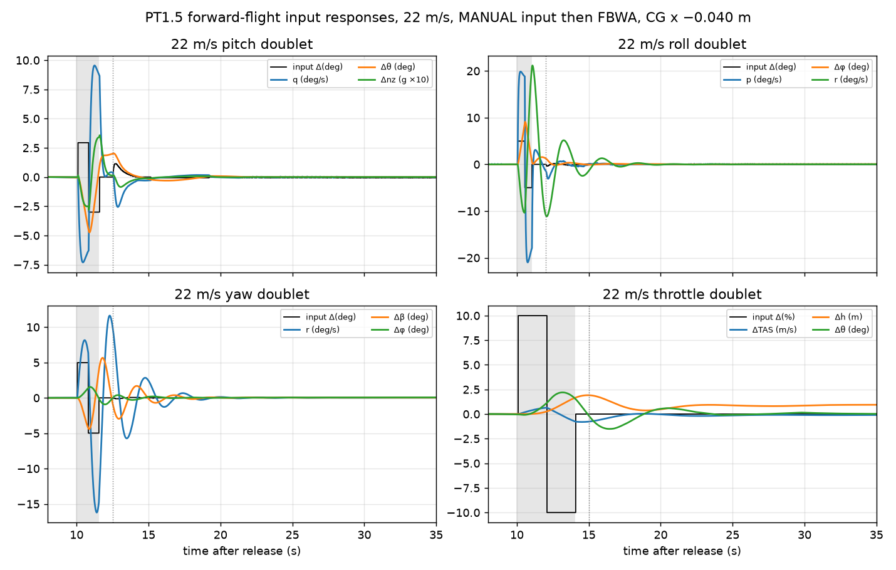

# PT1.5 Hover and Fixed-Wing Flight Mechanics Assessment

## Status

"Preliminary"

"Revision History: Rev A, 14 October 2026, initial release (flight dynamics, ZeynepB5793); Rev B, 15 October 2026, hover and fixed-wing input responses added"

"Replacement Log: Supersedes the CG conclusions of [note 0001](../0001-Preliminary-Fixed-Wing-Stability-Analysis/information-note.md) for the October aerodynamic database; note 0001 remains the record of the ADB v1.1 study."

"Reference: [Aerodynamic Data Clarification Request](../0002-Aerodynamic-Data-Clarification-Request/information-note.md), [Preliminary Design Aerodynamic Database](../../Aerodynamics/0002-Preliminary-Design-Aerodynamic-Database/information-note.md), [FDM update of 14 October](../../../../../src/tools/flight_dynamics_model/docs/update_2026_10_14.md)"

## Project Description

This note summarizes the flight mechanics position of Spearhead PT1 as flown and PT1.5 as it will
be built, for hover and for fixed-wing flight. It combines the PT1 DataFlash logs (19 September
2026), the October aerodynamic database with the 11 October control delivery, the 14 October
drawing stations, the flight dynamics model (FDM) and ArduPlane 4.7.1 software-in-the-loop
(SITL) runs.

It is a preliminary engineering assessment. It supports CG, pusher and test-sequence decisions;
it is not a flight clearance.

### Objective

- Estimate the PT1 CG and hover margins from the logs with the correct rotor stations.
- Define a PT1.5 CG window that is statically stable, can be trimmed and can hover.
- Quantify fixed-wing trim, pusher performance and dynamic modes inside that window.
- List the data still needed before the first transition.

### Background

| Item | Value |
|---|---|
| Axes | Body x forward, y right, z down; origin at the CFD origin (wing root quarter-chord, unconfirmed: AQ-01) |
| Aero reference | S 1.805 m², b 3.95 m, c 0.457 m, rho 1.021 kg/m³ (Ankara test field, hot day) |
| Lift rotors | KDE5215XF-220, KDE-CF215-DP 21.5×7.3, 12S; stations x +0.675 / −0.750 m, y ±0.55 m, z −0.043 m |
| Rotor centroid | x −0.0375 m |
| Pusher | Station (−0.374, 0, z); z open between +0.040 and −0.050 m body; motor (KDE or MAD) and wooden 20×12 propeller undecided |
| PT1 as flown (log17) | 17.9 kg, wings on, no pusher |
| PT1.5 | 21 kg build estimate (adds pusher, 12S pusher pack, ESC, servos, tail electronics, skin) |

## Methodology

### Log analysis

Hover segments were taken where all four lift outputs exceeded 1250 µs, altitude exceeded 1 m,
attitude stayed within ±5° and climb rate within ±0.2 m/s. Output PWM was converted to thrust with
the KDE static curve at the logged pack voltage. The front/rear thrust split gives the CG station
through the moment balance about the rotor stations; total thrust checks the mass.

### Model

The FDM uses the October base table (restored from its export center (−0.1, 0, +0.15) m to the
origin), the 11 October control increments (±15° measured, linear continuation to ±30°), a
static KDE lift model, an analytical MAD V8013 150KV / APC 20×12 pusher model, build-up inertia
and vortex-lattice rate damping. Static margin is stick-fixed at trim, from a small alpha change at
constant speed (wing, tail and fuselage loads). Hover headroom is the busiest rotor's thrust
against its thrust at 95 % spin.

### SITL

ArduPlane 4.7.1 runs against the FDM in lockstep at 200 Hz with the Ankara home, density-consistent
pitot airspeed and density-compensated hover thrust. Acceptance criteria are those of the Flight
Deck runners.

## Results and Deliverables

### Hover

#### PT1 mass and CG from the logs

| Flight | Configuration | Thrust from KDE curve | Front share | CG x |
|---|---|---:|---:|---:|
| Log 14 | Without wings | 14.8 kg | 48.0 % | −0.067 m |
| Log 16, three segments | Without wings | 15.1–15.4 kg | 49.4–50.4 % | −0.046 to −0.032 m |
| Log 17, segments 1–2 | Without wings | 15.3–15.6 kg | 49.4 % / 52.1 % | −0.047 / −0.008 m |
| Log 17, segment 3 | Wings on | 17.8 kg | 49.4 % | −0.046 m |

The KDE curve reproduces the stated 17.9 kg wings-on mass within 1 %, so the static thrust model
holds for hover. The wings-on CG from its single segment is −0.046 m, 9 mm aft of the rotor
centroid. Wingless segments spread from −0.067 to −0.008 m (wind, low-altitude ground effect, the
yaw split, and possibly different equipment placement), so treat the log-derived CG as about
±20 mm. PT1 hovered close to balance; CG offset from the rotor centroid is not a hover limitation.

#### Hover headroom

| Case | Busiest rotor / max thrust at 44.4 V | at 42 V |
|---|---:|---:|
| PT1.5, 21 kg, CG −0.040 m | 65 % | 69 % |
| PT1.5, 22.5 kg (with ballast), CG −0.040 m | 69 % | 74 % |

Hover current in SITL at 21 kg is about 83 A from the lift pack.

#### Yaw authority

PT1 logs show the counter-clockwise pair near 1650 µs and the clockwise pair near 1350–1450 µs,
with the clockwise motors reaching the spin floor. The split follows heading, which points to
weathervaning in wind plus a fixed bias of about 170 µs. Estimated weathervane torque is 2.1 N·m at
5 m/s and 5.3 N·m at 8 m/s crosswind against about 4.4 N·m of rotor yaw authority.

Recommended: cant the lift motors 3–5° outboard to gain yaw authority from thrust, set
`Q_WVANE_GAIN` (currently 0 with weathervaning enabled), then raise `Q_A_RAT_YAW_I`.

#### Other hover findings

- Lift current is not measured on the aircraft (power-module pins); battery failsafe actions were
  set to none in log17.
- Pack plus wiring resistance is about 40–55 mΩ.
- The harmonic notch is disabled; vibration peaks are at 75–85 Hz and 40–43 Hz.
- The aircraft runs `SCHED_LOOP_RATE` 300.

#### Hover in SITL

| Run | Result |
|---|---|
| Hover hold, calm | Passed: max tilt 0.6°, altitude error 0.4 m |
| Hover hold, 6 m/s headwind + 3 m/s gust | Passed: max tilt 0.8°, altitude error 1.0 m |
| Front-right lift motor out at 20 s | Left the attitude envelope 0.4 s after the failure (quad-X has no single-motor-out capability) |

#### Hover input responses (SITL)

Pilot doublets at 20 m in calm air with the PT1 VTOL gains as logged: attitude ±8° in QHOVER, yaw
stick ±20 % in QHOVER, collective ±10 points in QSTABILIZE; each half lasts 2 s, then sticks
return to neutral. Response is measured against the firmware's own desired attitude and rate
(DataFlash `ATT`, `RATE`).

| Input | Rise to 90 % | Peak | After neutral | Peak rate | Coupling |
|---|---:|---|---|---:|---|
| Pitch ±8° | 0.60 s | +8.9° (11 % over); −10.9° on the 16° reversal (36 % over) | 1.0° past zero; within 1° after 0.6 s | 44°/s | roll 0.6°, heading 1.6° |
| Roll ±8° | 0.65 s | +9.4° (17 %); −9.9° (24 %) | 1.1° past zero; within 1° after 1.1 s | 35°/s | pitch 0.9°, heading 6.4° |
| Yaw stick ±20 % (demand up to 43–47°/s) | not reached | +14.9 / −14.6°/s, 1.3 s behind the demand | heading oscillates, period 8.0 s, damping ratio about 0.11; within 2° only after 28 s | — | roll/pitch < 0.1° |
| Collective ±10 points | — | vertical acceleration +1.1 / −1.6 m/s², climb 2.2 m/s, +3.7 m | QHOVER holds the new height (+1.6 m) | — | attitude 0.6° |

Lift outputs stayed between 1525 and 1796 µs in every run, clear of the 1100–1940 µs range ends.
Height stayed within 0.4 m during the attitude doublets.

- Pitch and roll follow the demand quickly and settle without oscillation. The overshoot on the
  reversal (24–36 %) is the largest feature and is worth comparing with the first PT1.5 hover log.
- Yaw is the weak hover axis. The yaw-rate loop output peaks at 0.44 of full scale
  (`Q_A_RAT_YAW_P` 0.5, `Q_A_RAT_YAW_I` 0.018) against an estimated yaw inertia of 8.1 kg·m²: the
  aircraft reaches a third of the demanded rate, and the heading-hold loop then oscillates with
  little damping. A roll input also turns the heading by 6°. This matches the yaw findings from
  the PT1 logs above. Yaw inertia and rotor reaction torque (static KDE data, no motor dynamics)
  are estimates, so the numbers are indicative.
- QHOVER does not hold position. All runs drifted 43–45 m in 45 s at about 1.4 m/s because the
  model aircraft sits 0.15–0.25° from level while the firmware estimates it level; a pilot or
  QLOITER removes this in flight.

#### Fixed-wing input responses at 22 m/s (SITL)

Open-loop surface and pusher doublets in MANUAL from the 22 m/s trim at 100 m, followed by FBWA
with the 9 October transition parameters. Elevator trim is −18.2°, so every frame uses elevator
data beyond the measured ±15°.

| Input | Primary response | Coupling | Recovery |
|---|---|---|---|
| Elevator ±3°, 0.75 s each | q 7.3°/s in the first half (2.4°/s per degree), 9.5°/s on the reversal; pitch 4.7°, alpha 1.5°, load factor 0.36 g | speed 0.5 m/s, height 1.2 m | rates within 1°/s 1.9 s after the input, no oscillation |
| Aileron ±5°, 0.5 s each | p 20°/s in the first half (4.0°/s per degree), 21°/s on the reversal; bank 9.1° | adverse yaw: r 21°/s, sideslip 5.5°, heading 7.6° | Dutch roll, period 2.53 s, damping ratio 0.24; rates within 1°/s after 5.2 s |
| Rudder ±5°, 0.75 s each | r 16°/s, sideslip 5.7° | bank 1.5° | Dutch roll, period 2.50 s, damping ratio 0.22; 4.9 s |
| Pusher ±10 points, 2 s each | speed 0.8 m/s | pitch 2.2°, height 1.9 m | rates 1.7 s; FBWA keeps +0.9 m |

All four runs passed their input and recovery checks.

- The pitch response is heavily damped, as the linear short period predicts (1.06 Hz, damping
  ratio 0.78).
- The Dutch roll seen after the aileron and rudder inputs (0.39–0.40 Hz, damping ratio 0.22–0.24)
  agrees with the linear mode (0.41 Hz, 0.24). The nonlinear model with the firmware in the loop
  confirms the linear lateral analysis.
- Aileron gives strong adverse yaw: sideslip reaches 5.5° from 5° of aileron and the yaw rate
  equals the roll rate. With Cnr from the lifting surfaces only, real yaw damping is probably
  higher, but turns will need rudder coordination.
- The trim needs 2.1° of rudder against a yaw moment of 1.5 N·m and a roll moment of 0.4 N·m. They come from the lateral
  loads in the elevator increments of the 15 m/s plane (−0.65 N·m yaw for −5°, measured), which the
  model extrapolates to −18° and blends into 22 m/s. A symmetric elevator deflection should give
  almost no yaw, so these loads are likely numerical; see the limitations.

### Fixed-wing flight

#### Static stability and CG window

The stick-fixed neutral point at 22 m/s trim is at about x −0.069 m (z +0.065 m); from the base
table alone it is −0.0585 m. Results for PT1.5 at 21 kg, z +0.065 m, ±30° travel:

| CG x (m) | Static margin, 22 m/s | Elevator trim 20 / 22 / 24 m/s | Hover busiest rotor |
|---:|---:|---|---:|
| −0.060 | +2.0 % | −16.8° / −15.0° / −13.4° | 67 % |
| −0.0475 (PT1 as flown) | +4.8 % | −19.5° / −17.0° / −14.9° | 65 % |
| **−0.040 (PT1.5 target)** | **+6.4 %** | **−21.1° / −18.2° / −15.8°** | **65 %** |
| −0.025 | +9.7 % | −24.3° / −20.6° / −17.7° | 66 % |
| 0.000 | +15.2 % | −29.4° / −24.6° / −20.8° | 68 % |

Window at 22 m/s: x −0.046 to −0.027 m, bounded by static margin ≥ 5 % (aft) and elevator ≥ −20°
(forward). Hover does not constrain it. Every stable CG needs more than the measured −15° of
elevator, so the trim relies on extrapolation until the AQ-12 cases arrive.

PT1.5 without ballast is estimated at x −0.08 m (static margin about −3 %): the pusher, its pack
and the tail electronics move the CG aft. Placing the 12S pusher pack forward (about +0.5 m)
brings it to about −0.02 m; alternatively about 0.9 kg of nose ballast at +0.8 m reaches the
target. The built aircraft must be weighed.

#### Trim and pusher performance at the target CG

| TAS | Alpha | Elevator | Pusher command | Pusher current |
|---:|---:|---:|---:|---:|
| 20 m/s | 2.54° | −21.1° | 77 % | 15.0 A |
| 22 m/s | 1.49° | −18.2° | 83 % | 18.0 A |
| 24 m/s | 0.70° | −15.8° | 90 % | 21.8 A |
| 26 m/s | 0.08° | −14.6° | 96 % | 26.3 A |

Estimated pusher thrust at full command is 62.9 N static, 36.2 N at 24 m/s and 32.8 N at 26 m/s.
The 24 A sustainable current is passed between 24 and 26 m/s. Stall speed at 21 kg is about
12.6 m/s (CLmax ≈ 1.40). Suggested PT1.5 speeds: minimum 17, cruise 21, maximum 26 m/s.

A pusher thrust line above the CG adds nose-down moment and more elevator demand: at +40 mm
(the highest option) about 3 N·m at cruise thrust, roughly 2° of elevator. The lowest option
(−50 mm, close to the CG height) is preferred.

#### Dynamic modes at 22 m/s

| CG x (m) | Short period | Phugoid | Dutch roll | Spiral |
|---:|---|---|---|---|
| −0.060 | 0.90 Hz, ζ 0.91 | 0.094 Hz, ζ 0.10 | 0.40 Hz, ζ 0.24 | +0.078 1/s |
| −0.040 | 1.06 Hz, ζ 0.78 | 0.101 Hz, ζ 0.10 | 0.41 Hz, ζ 0.24 | +0.078 1/s |
| −0.025 | 1.16 Hz, ζ 0.71 | 0.105 Hz, ζ 0.10 | 0.42 Hz, ζ 0.23 | +0.079 1/s |

Longitudinal modes are stable throughout. The spiral mode is mildly divergent (time to double
about 9 s), which the autopilot handles. Roll subsidence is fast (−20.6 1/s).

#### Transition in SITL (target CG)

| Run | Result |
|---|---|
| Hover → FBWA, 9 October parameters | Passed: 30.4 s sustained FBWA without lift, 24.2 m/s, peak pitch 2.1°, altitude loss 3.0 m |
| Hover → FBWA, later PT1.5 parameters (set since removed) | Passed: 26.1 s, 24.2 m/s, peak pitch 0.8°, altitude loss 0.9 m |
| Hover → FBWA, 6 m/s headwind | Passed on airspeed: 32.5 s, 24.2 m/s |

These runs use 25 m/s aerodynamic coefficients below 20 m/s; see the limitations.

### CG and pusher recommendations

1. Target CG x −0.040 m (window −0.046 to −0.027 m); weigh PT1.5 and place the pusher pack forward
   before adding ballast.
2. Mount the pusher at the lowest option (z −50 mm, drawing frame).
3. Hover-only flight until the CG is set, AQ-12 and AQ-18 are answered and the elevator mixing gain
   gives the full surface travel.

## Limitations

- The CFD origin location is assumed (AQ-01); a few centimeters of error shifts every static
  margin by several points.
- Elevator beyond ±15° is extrapolated (AQ-12).
- The neutral table is from 25 m/s. The 10 and 15 m/s neutral cases show much lower lift
  (CL at alpha 0°: 0.08 and 0.27 against 0.36), likely the fixed 30 N pusher slipstream over the
  tail; the model predicts too much wing-body lift between about 10 and 20 m/s, and the slipstream
  effect does not follow pusher thrust (AQ-18).
- CG z, inertia and rate damping are estimates; Cnr (−0.04) covers lifting surfaces only.
- No rotor inflow, ground effect, propwash or lift-rotor drag in forward flight.
- Pusher model is MAD V8013 / APC 20×12 Sport, not the planned wooden propeller.
- Wind is uniform steady wind with 1-cosine gusts.
- The elevator increments carry lateral loads (yaw and roll) from the 15 m/s cases, extrapolated
  beyond ±5°. At 22 m/s trim they require 2.1° of rudder. Removing lateral loads from symmetric
  elevator increments is proposed but not applied.
- The hover yaw response depends on the estimated yaw inertia and on static rotor torque; motor
  and rotor speed dynamics are not modelled.
- In near-hover, the firmware's attitude estimate differs from the model attitude by about 0.2°,
  which causes the QHOVER drift reported above.

## Recommendations

- Answer AQ-01, AQ-12 and AQ-18 before the first transition.
- Static thrust test of the chosen pusher motor and wooden 20×12 propeller.
- Weigh PT1.5 and measure CG x and z; swing test for pitch inertia if practical.
- Align the aircraft parameters (battery failsafe actions, airspeeds, mixing gain, weathervane) and the
  SITL parameters, then repeat the transition runs.
- Fit lift-current sensing; enable and tune the harmonic notch before pusher flights.
- On the first PT1.5 hover, fly small pitch, roll and yaw stick doublets and compare them with
  the hover responses above; yaw is the axis to watch. Review the yaw rate and heading gains
  after the motor cant and weathervane settings.
- Include aileron-to-rudder mixing in the aircraft parameter alignment before fixed-wing flight.

## Traceability

| Source | Location |
|---|---|
| PT1 logs | DataFlash 00000014–00000017 (19 September 2026) |
| Aerodynamic data | `src/tools/flight_dynamics_model/data/aerodynamics/tail_update_2026_10_07/` |
| Aircraft profiles | `src/tools/flight_dynamics_model/aircraft_configs/pt1_as_built.yaml`, `pt15.yaml` |
| CG summary and window | `spearhead/cg_card.py`; Flight Deck Analyze → CG window |
| SITL runs | ArduPlane 4.7.1 (dbe79216), `spearhead/sitl/quad.py` |
| Input responses | `data/input_response_metrics.json`, `figures/`; runs from `spearhead.sitl.quad --doublet` and `spearhead.sitl.flight <axis>_doublet`, analysed with `src/tools/flight_dynamics_model/scripts/analyse_input_responses.py` (raw recordings are not kept in Git) |

## Quality Assurance

- 562 FDM tests pass, including moment-reference restoration, profile geometry, trim, CG summary,
  wind, failures and battery telemetry.
- Moment restoration matches Nondimit's own recentering within 6×10⁻¹⁴ N·m.
- Control signs, sideslip symmetry and the absence of double-counted pusher thrust were checked
  against the September Aero notes.
- The log-derived mass (17.8 kg) agrees with the stated mass (17.9 kg).
- The Dutch roll measured in the SITL doublets agrees with the linear mode within 4 % in period
  and 0.02 in damping ratio.

## Conclusion

PT1 hovered close to balance with its CG about 9 mm (±20 mm) aft of the rotor centroid; hover margin is not the
constraint for PT1.5. The fixed-wing constraint is a narrow window, x −0.046 to −0.027 m, set by
static margin and elevator authority, and PT1.5 as built will sit aft of it unless masses are moved
forward. Inside the window the aircraft is statically and dynamically stable in the model, and SITL
transitions pass, but elevator trim and low-speed lift rest on extrapolated or unexplained data.
Input responses are well damped in pitch and roll; hover yaw is sluggish and lightly damped, and
aileron inputs need rudder coordination. The next flight should be hover-only, with small doublets
to check the hover responses.
