# Spearhead PT1 Wiring Diagram

**Doc ID:** SPH-E-005
**Author:** errrks
**Date:** June 26, 2026
**Source:** SPH-E-001 (electrical master, Rev 0.19) §4.6 harness connection table (H1-H21). Per-conductor detail: `Spearhead PT1 Wire Data.xlsx`.

**As-built note (Oct 14, 2026):** the tail PM12S-3 Vx is bridged to 6V on PT1, not the 8V design value in SPH-E-001 Rev 0.19. The H15 and H16 labels below show the as-built 6V. 8V is PT2. See SPH-E-001 Rev 0.21. The PNG and SVG were regenerated from the mmd on Oct 14, 2026.

**Propulsion is stale (Oct 16, 2026):** PT1 flies KDE ESCs on physical PWM from the 6C I/O PWM OUT port, not the DroneCAN ESC nodes and H11 CAN runs drawn below, and the wing servos sit on a breakout at the FMU PWM OUT port at 8.0 V. PT1.5 adds a pusher on a separate 12S 15 Ah pack. See SPH-E-006 (`pt1-as-built-note.md`). Redraw after the channel map is read back (SPH-E-006 AB-03).

Auto-generated from the harness table. Each arrow is one harness and the label is the harness ID plus wire gauge and connector. The Mermaid source below is the diagram. Regenerate it after any §4.6 change.

## Connection diagram (Mermaid source, renders on GitHub)

```mermaid
flowchart LR
  subgraph Z0["Forward bay"]
    BAT["12S 22Ah LiPo<br/>QS8-S anti-spark"]
  end
  subgraph Z1["CG bay / boom roots"]
    FCHUB["FCHUB-12S V2<br/>PDB + BECs + 440A"]
    BUCK["robocombo buck<br/>8.4V (fwd)"]
    HUB(["CAN splitter/hub"])
  end
  subgraph Z2["Avionics shelf"]
    FC["Pixhawk 6C"]
    PM02["PM02 V3"]
    F9P["u-blox F9P<br/>primary GPS"]
    SIK["Holybro SiK V3<br/>telemetry"]
    RX["Radiolink R9DS<br/>RC · SBUS"]
    USD1["Ainstein US-D1<br/>altimeter"]
    PITOT["Pitot transducer"]
    LVKILL{{"LV kill switch"}}
    P5V(["Peripheral 5V rail"])
  end
  subgraph Z3["Booms x4"]
    ESC1["ESC1 · node1"]
    ESC2["ESC2 · node2"]
    ESC3["ESC3 · node3"]
    ESC4["ESC4 · node4"]
    M1(["M1 FR"])
    M2(["M2 RL"])
    M3(["M3 FL"])
    M4(["M4 RR"])
  end
  subgraph Z4["Tail group"]
    PM12["PM12S-3 (tail)<br/>Vx 6V as built (8V design) + 5V"]
    HERE4["Here4 · node11<br/>secondary GPS"]
    CANPWM["CAN-L4-PWM · node12"]
    RUDL(["Ruddervator L"])
    RUDR(["Ruddervator R"])
  end
  subgraph Z5["Wing panels"]
    FLAPR(["Flaperon R"])
    FLAPL(["Flaperon L"])
  end
  subgraph Z6["Exterior"]
    LED["WS2812 strips"]
  end

  BAT -->|"H1 HV main<br/>8AWG · QS8-S"| FCHUB
  FCHUB -->|"H2 FC pwr leg<br/>16AWG · XT60"| PM02
  FCHUB -->|"H3 HV<br/>12AWG · XT90S"| ESC1
  FCHUB -->|"H3 HV<br/>12AWG · XT90S"| ESC2
  FCHUB -->|"H3 HV<br/>12AWG · XT90S"| ESC3
  FCHUB -->|"H3 HV<br/>12AWG · XT90S"| ESC4
  ESC1 -->|"H4 3-phase<br/>14AWG · bullet"| M1
  ESC2 -->|"H4 3-phase<br/>14AWG · bullet"| M2
  ESC3 -->|"H4 3-phase<br/>14AWG · bullet"| M3
  ESC4 -->|"H4 3-phase<br/>14AWG · bullet"| M4
  ESC4 -->|"H5 tail HV spur<br/>18AWG · XT30"| PM12
  PM02 -->|"H6 5.2V + V/I<br/>POWER1 (BATT2)"| FC
  FCHUB -->|"H7 5V"| LVKILL
  LVKILL -->|"H7 5V_SW"| P5V
  FCHUB -->|"HV in<br/>(FCHUB pads)"| BUCK
  FC -->|"H8 PWM<br/>26AWG tw"| FLAPR
  FC -->|"H8 PWM<br/>26AWG tw"| FLAPL
  BUCK -->|"H9 8.4V"| FLAPR
  BUCK -->|"H9 8.4V"| FLAPL
  FC -->|"H10 CAN1<br/>24AWG TP · 120R"| HUB
  HUB -->|"H11 CAN"| ESC1
  HUB -->|"H11 CAN"| ESC2
  HUB -->|"H11 CAN"| ESC3
  HUB -->|"H11 CAN"| ESC4
  FC -->|"H12 serial GPS1"| F9P
  HUB -->|"H13 CAN trunk"| HERE4
  HERE4 -->|"H13 daisy · 120R"| CANPWM
  FCHUB -->|"H14 5V LED feed<br/>22AWG"| LED
  PM12 -->|"H15 Vx 6V rail (PT1 as built)"| CANPWM
  PM12 -->|"H15 5V logic"| CANPWM
  PM12 -->|"H15 5V"| HERE4
  CANPWM -->|"H16 PWM 6V"| RUDL
  CANPWM -->|"H16 PWM 6V"| RUDR
  FC -->|"H17 TELEM1"| SIK
  FC -->|"H18 RC IN · SBUS"| RX
  FC -->|"H19 UART4"| USD1
  FCHUB -->|"H20 V/I sense<br/>POWER2 (BATT1)"| FC
  PITOT -->|"H21 I2C / ADC"| FC
  P5V -->|"5V"| F9P
  P5V -->|"5V"| RX
  P5V -->|"5V"| SIK

  linkStyle 0 stroke:#c0392b,stroke-width:3px
  linkStyle 1 stroke:#c0392b,stroke-width:3px
  linkStyle 2 stroke:#c0392b,stroke-width:3px
  linkStyle 3 stroke:#c0392b,stroke-width:3px
  linkStyle 4 stroke:#c0392b,stroke-width:3px
  linkStyle 5 stroke:#c0392b,stroke-width:3px
  linkStyle 6 stroke:#e67e22,stroke-width:2px
  linkStyle 7 stroke:#e67e22,stroke-width:2px
  linkStyle 8 stroke:#e67e22,stroke-width:2px
  linkStyle 9 stroke:#e67e22,stroke-width:2px
  linkStyle 10 stroke:#c0392b,stroke-width:3px
  linkStyle 11 stroke:#7f8c8d,stroke-width:1.5px,stroke-dasharray:5 4
  linkStyle 12 stroke:#b7950b,stroke-width:1.5px
  linkStyle 13 stroke:#b7950b,stroke-width:1.5px
  linkStyle 14 stroke:#c0392b,stroke-width:3px
  linkStyle 15 stroke:#229954,stroke-width:2px
  linkStyle 16 stroke:#229954,stroke-width:2px
  linkStyle 17 stroke:#f39c12,stroke-width:2px
  linkStyle 18 stroke:#f39c12,stroke-width:2px
  linkStyle 19 stroke:#2471a3,stroke-width:2px
  linkStyle 20 stroke:#2471a3,stroke-width:2px
  linkStyle 21 stroke:#2471a3,stroke-width:2px
  linkStyle 22 stroke:#2471a3,stroke-width:2px
  linkStyle 23 stroke:#2471a3,stroke-width:2px
  linkStyle 24 stroke:#7d3c98,stroke-width:2px
  linkStyle 25 stroke:#2471a3,stroke-width:2px
  linkStyle 26 stroke:#2471a3,stroke-width:2px
  linkStyle 27 stroke:#b7950b,stroke-width:1.5px
  linkStyle 28 stroke:#f39c12,stroke-width:2px
  linkStyle 29 stroke:#b7950b,stroke-width:1.5px
  linkStyle 30 stroke:#b7950b,stroke-width:1.5px
  linkStyle 31 stroke:#229954,stroke-width:2px
  linkStyle 32 stroke:#229954,stroke-width:2px
  linkStyle 33 stroke:#7d3c98,stroke-width:2px
  linkStyle 34 stroke:#7d3c98,stroke-width:2px
  linkStyle 35 stroke:#7d3c98,stroke-width:2px
  linkStyle 36 stroke:#7f8c8d,stroke-width:1.5px,stroke-dasharray:5 4
  linkStyle 37 stroke:#7f8c8d,stroke-width:1.5px,stroke-dasharray:5 4
  linkStyle 38 stroke:#b7950b,stroke-width:1px,stroke-dasharray:3 3
  linkStyle 39 stroke:#b7950b,stroke-width:1px,stroke-dasharray:3 3
  linkStyle 40 stroke:#b7950b,stroke-width:1px,stroke-dasharray:3 3

  classDef z0 fill:#fdebd0,stroke:#566573,color:#1b2631;
  class BAT z0;
  classDef z1 fill:#d6eaf8,stroke:#566573,color:#1b2631;
  class FCHUB,BUCK,HUB z1;
  classDef z2 fill:#d5f5e3,stroke:#566573,color:#1b2631;
  class FC,PM02,F9P,SIK,RX,USD1,PITOT,LVKILL,P5V z2;
  classDef z3 fill:#fadbd8,stroke:#566573,color:#1b2631;
  class ESC1,ESC2,ESC3,ESC4,M1,M2,M3,M4 z3;
  classDef z4 fill:#e8daef,stroke:#566573,color:#1b2631;
  class PM12,HERE4,CANPWM,RUDL,RUDR z4;
  classDef z5 fill:#fcf3cf,stroke:#566573,color:#1b2631;
  class FLAPR,FLAPL z5;
  classDef z6 fill:#f2f3f4,stroke:#566573,color:#1b2631;
  class LED z6;
```

## Edge legend (signal class -> colour)

| Class | Colour | Harnesses |
|---|---|---|
| HV power | red (thick) | H1, H2, H3 x4, H5, BUCK HV in |
| Motor phase | orange | H4 x4 |
| DroneCAN | blue | H10, H11 x4, H13 |
| Servo PWM | green | H8 x2, H16 x2 |
| Servo power | amber | H9 x2, H15 (Vx 6V as built on PT1, 8V design) |
| 5V / BEC power | gold | H7, H14, H15 (5V logic) |
| Serial / UART | purple | H12 (F9P), H17 (SiK), H18 (RC SBUS), H19 (US-D1) |
| Analog sense | grey (dashed) | H6 (POWER1), H20 (POWER2), H21 (pitot) |
| 5V rail tap | gold (dotted) | peripheral rail to F9P / RX / SiK (per SPH-E-001 §4.4) |

## Notes

- The tail HV spur (H5) and tail CAN trunk (H13) both run along the tail-carrying boom; H5 breaks out at that boom's ESC-lead extension joint (shown from ESC4).
- HV kill: none for PT1 (software E-stop + QS8-S unplug). LV kill (H7) cuts only the FC supply path and the peripheral 5V rail.
- RC is SBUS into the dedicated RC-IN port; telemetry (SiK V3) is a separate MAVLink link on TELEM1.
- For exact pins, lengths, and colours per conductor see the wire-data workbook (102 conductors).
