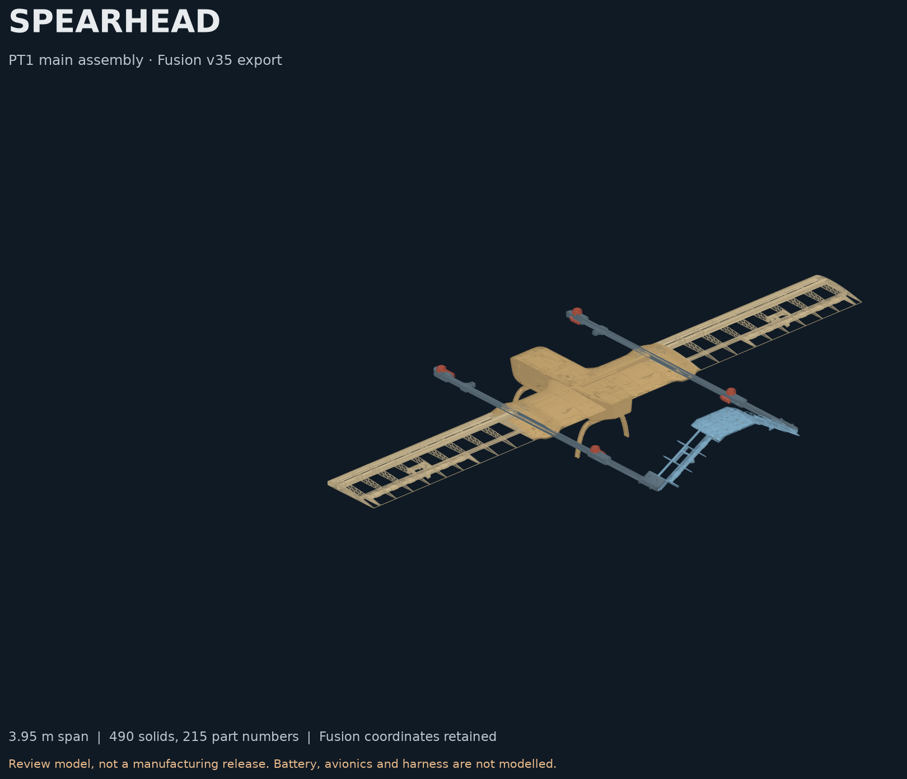

# Spearhead PT1 assembly

The PT1 main assembly as a STEP file, its part list, and a Build123D loader,
checks and web viewer. It is a **review model**, not a manufacturing release.

The source is Fusion design `AR-SH-PT1-0000 PT1` version 35 (Project Spearhead /
PT1), exported without the hidden `REF - NOT PT1 BUILD` group.



## Contents

| File | Content |
| --- | --- |
| `pt1/AR-SH-PT1-0000_PT1_v35_noREF.step` | Assembly, AP214, tracked with Git LFS |
| `pt1/pt1_part_numbers.csv` | 215 part numbers: name, description, material code, quantity per side, family |
| `pt1/pt1_assembly_manifest.csv` | Every solid with its occurrence path, volume and centroid |
| `pt1/pt1_materials_table.csv` | Material, density, quantity and mass per part number |
| `pt1/pt1_side_review.csv` | Left and right comparison of every part |
| `pt1/pt1_renumber_map_v30_v32.csv` | Part number and path changes from Fusion v30 to v32 |
| `pt1/native-bodies.json` | Volume, centroid and material of every numbered body, read from Fusion v35 |

Fusion v33 and v34 changed only group names and two descriptions. Fusion v35 removed a
thin wall from the tip ribs 22208 and 23208. The side review was computed on v32, and
the tip-rib pair was re-checked on v35. See the
[review notes](../../reviews/pt1-assembly/README.md).

## Run

Python 3.13 and Git LFS are required. From the repository root:

```sh
git lfs pull
python3.13 -m venv src/design/.venv
src/design/.venv/bin/pip install -r src/design/requirements.lock.txt
src/design/.venv/bin/python src/design/spearhead.py
```

This loads the STEP and writes `src/design/output/spearhead.step`.

```sh
# Offline preview:
src/design/.venv/bin/python src/design/render.py
# Checks against the Fusion body dump and part list, plus STEP export/import roundtrip:
src/design/.venv/bin/python src/design/validate.py
```

`build_aircraft()` returns a labeled Build123D `Compound`: five systems, then
subsystems and families, then parts named `NNNNN-Name`. Parts stay separately
selectable. `part_occurrences()` walks the numbered parts and `part_numbers()`
reads the part list. `--show` optionally uses an already-installed `ocp_vscode`
viewer. Coordinates are **millimetres, X aft, Y span, Z up**.

[Viewer source and hosting instructions](viewer/README.md).

## Counts

| Item | Count |
| --- | --- |
| Part numbers | 215 |
| Part occurrences | 426 |
| Solids in the STEP | 490 |
| Numbered bodies in Fusion | 482 |

Solids exceed bodies by 8 because each of the 4 diagonal gear braces (15105 and
15205, 2 of each) is one Fusion body made of 3 disjoint lumps, which STEP writes
as 3 solids.

## Known limits

- Battery, avionics and harness are not modelled.
- Bought parts (motors, ESCs, aileron hinges) have no datasheet mass yet.
- The motor and ESC CAD models are not mirror-symmetric, so the right side uses
  rotated copies of the left parts, seated on the mounts the same way as the left.
- Real left and right differences are listed in the side review, including the
  mid, side and tail-end skins, gear mounting plates, tail spar connectors, tail skin covers
  and rear motor mount plates.
- Validity, volume and centroid checks do not establish fit, mass or flight
  readiness.

## Verification and the volume trap

See [review notes](../../reviews/pt1-assembly/README.md) and
[validation.json](../../reviews/pt1-assembly/validation.json).

**Do not use the default `solid.volume` for mass estimates on this dataset.**
OCP's non-adaptive integration is inaccurate on spline faces: it differed by up
to 0.43 % between two exports of the same PT1 skin panel, and by about 18.8 % on
a leading-edge part of the earlier reconstruction. `spearhead.volume_mm3()` uses
adaptive Gauss integration (`Eps=1e-9`) and resolves the discrepancy.
