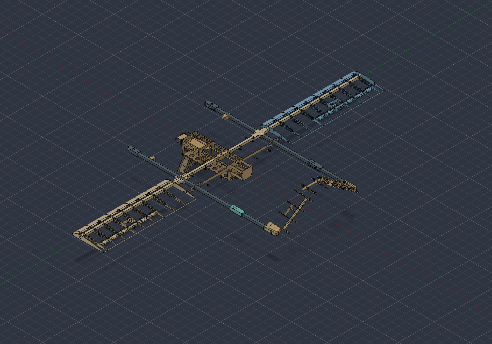

# Spearhead Build123D assembly

A **STEP-backed structural reconstruction**, not a parametric redesign or an
as-built aircraft definition. Captured from the current **Project Spearhead**
Fusion cloud project on **2026-09-26**. The original Fusion documents were not
saved, updated, or edited.



## Run

Python 3.13 and Git LFS are required. From the repository root:

```sh
git lfs pull
python3.13 -m venv src/design/.venv
src/design/.venv/bin/pip install -r src/design/requirements.lock.txt
src/design/.venv/bin/python src/design/spearhead.py
```

The generated aircraft is `src/design/output/spearhead.step`. Import it into
Fusion, FreeCAD or another STEP viewer. Re-running the command rebuilds it from
the immutable source exports; nothing depends on Fusion being installed.

```sh
# Saved-visible source geometry only, without reconstruction additions:
src/design/.venv/bin/python src/design/spearhead.py --as-exported --output src/design/output/saved-visible.step
# Offline preview:
src/design/.venv/bin/python src/design/render.py
# Geometry checks and STEP export/import roundtrip:
src/design/.venv/bin/python src/design/validate.py
```

`build_aircraft()` returns a labeled Build123D `Compound` with named subsystem
and body children. `--show` optionally uses an already-installed `ocp_vscode`
viewer. STEP geometry is imported, not fused, so parts remain separately
selectable. Coordinates are **millimetres, X aft, Y span, Z up**.

## Chosen baseline

There is no current complete-aircraft master in the inspected cloud project.
The freshest plausible structural configuration combines these separate designs
in their existing common coordinates:

| Subsystem | Fusion design | Version | Last saved (UTC) |
| --- | --- | --- | --- |
| Fuselage | `fuselage_v2` | 41 | 2026-09-22 |
| Main wing | `main_wing_structure` | 42 | 2026-08-07 |
| V-tail | `tail_wing_structure_v2_USER_EDITS_NOW` | 15 | 2026-08-05 |
| Booms and motor mounts | `motor_mount` | 7 | 2026-08-06 |
| Landing gear | `lg` | 3 | 2026-06-24 |

The baseline is the latest **CAD available in those designs**, not a claim that
it matches the aircraft currently flying. Exact cloud lineage IDs, timestamps,
body visibility and linked revisions are in `fusion_snapshot/*/manifest.json`.
`motor_mount` still links to tail v14, while standalone tail v15 is newer; this
assembly deliberately uses v15. No cloud reference was updated in place.

### Explicit reconstruction decisions

- Main-wing v42 has a full-width spar and only one detailed outer panel.
  **47 solids** wholly outboard of Y=-670 mm are mirrored across XZ. The blue
  panel is inferred, including handed details; it is not a verified right-wing
  manufacturing design. Existing central structure and boom fittings are not
  duplicated.
- Three bodies of the fourth motor mount are hidden in v7. They were copied
  into a disposable unsaved Fusion document and exported without changing the
  original. The **actual hidden geometry** is restored in teal, not mirrored.
- Booms, mounts, landing gear and all original structural placements are STEP
  geometry. No arbitrary placement offsets or guessed tube dimensions are used.
- One tail spar object is a zero-volume point placeholder. STEP drops it;
  the manifest records it. No nonzero-volume selected native solid is missing.

The resulting model has **301 valid solids** and a **3,950 mm span**. The
saved-visible-only configuration contains 251 solids.

## What is included in the snapshot

All **26 f3d designs** in the current project were exported as both visible
**STEP** geometry and native **F3D archives**, including old/conceptual designs,
fixtures, molds and supplied equipment. They are preserved separately, not all
piled into the aircraft. F3D archives retain hidden geometry and native design
content; STEP exports follow the document's saved visibility. Large CAD files
are tracked with Git LFS. The dated cloud catalog also lists the drawing and
CSV, which are not 3D design exports.

The separate `Project Spearhead - Old`, Spearhead Wiring and Longshot projects
were not imported into this snapshot. `temp` initially failed because it was
saved in the Simulation workspace; switching its UI to Design allowed both
exports. This was resolved, not an outstanding missing file.

## Known gaps

- This is the **structural aircraft**, not a complete populated flight model.
  Current motors/propellers, electric pusher, battery, avionics, harness and
  covering skins have not been reconciled or fitted. Available equipment CAD is
  exported separately; old gas-engine references are not silently substituted
  for the current electric configuration.
- Loose connectors and incomplete/hidden structure in the source are retained
  as source evidence. Assembly validity does not establish mating fit, joint
  constraints, interference clearance, manufacturing readiness or flight safety.
- The landing-gear source is older than the fuselage source. No physical-build
  reconciliation was attempted.
- Historical exports can contain defective solids. See the per-file import
  inventory in the validation report; only selected assembly geometry is
  required to pass all solid-validity checks.

## Verification and the volume trap

See [review notes](../../reviews/fusion-reconstruction/README.md) and
[validation.json](../../reviews/fusion-reconstruction/validation.json).
All selected source solids are matched to native bodies using bounding boxes,
not fragile body names alone. Maximum measured bounds difference is under
0.01 mm. Adaptive volume integration agrees with Fusion's high-accuracy
properties within 0.018% for fuselage, main wing and tail.

**Do not use the default `solid.volume` for mass estimates on this dataset.**
OCP's non-adaptive integration reports an approximately 18.8% volume error on a
spline leading-edge part despite correct bounds. `spearhead.volume_mm3()` uses
adaptive Gauss integration (`Eps=1e-9`) and resolves the discrepancy. Native
and imported tessellation checks are retained as supporting evidence, not as
proof of exact surface equivalence. Summed volumes are not fused-union volume
or aircraft mass.

`fusion_snapshot/scripts/` contains the capture and measurement scripts.
Fusion capture scripts record this machine's original absolute export paths;
edit those paths before recapturing elsewhere. Normal assembly builds use
repository-relative paths and need no API access.
