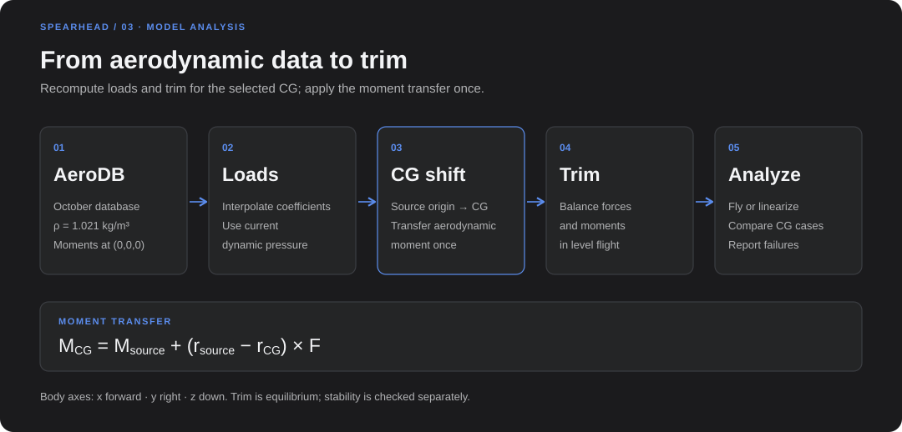

# Model reference

The Spearhead flight dynamics model (FDM): axes, aerodynamic data, aircraft profiles,
propulsion, CG handling, analyses and the Python/CLI interfaces. One engine serves the
simulation API, the stability tools, Model Lab and the ArduPilot SITL; none of them has its own
physics. For results see the [validation summary](validation_summary.md); for running the
firmware see [SITL integration](sitl_integration.md).

## Axes and state

- Inertial axes NED; body axes x forward, y right, z down.
- Origin at the CFD origin, assumed to be the wing root quarter-chord (open question AQ-01 in
  [Flight Dynamics note 0002](../../../../docs/information-note/phase-1/Flight-Dynamics/0002-Aerodynamic-Data-Clarification-Request/information-note.md)).
  The 14 October drawing uses X aft and Z up, so body = (−X, Y, −Z).
- State: NED position, body velocity, Euler angles (roll, pitch, yaw), body rates. Offline runs
  integrate with `scipy.integrate.solve_ivp`; the SITL stepper uses fixed-step RK4 on the same
  equations of motion (tests compare the two).
- Air-relative velocity `v_air = v_body − Rᵀ·wind_ned` drives aerodynamics, pusher inflow and
  the simulated pitot.

## Aerodynamic data

Two datasets are versioned under `aerodynamic_configs/`; aircraft and aerodynamics are chosen
independently (`load_aircraft_config(id, aerodynamics=...)`, `--aerodynamics` on the CLIs,
`aerodynamics:` in scenario YAML; an explicit choice wins).

| Dataset | Used by | Content |
|---|---|---|
| `adb_v1_1` | `reference_design` | Drag-corrected ADB v1.1 (`docs/information-note/phase-1/Aerodynamics/0002-Preliminary-Design-Aerodynamic-Database/assets/adb_v1_1_drag_correction.csv`), alpha/beta only, moment center (−0.15, 0, +0.15) m, rho 1.09 kg/m³; provisional control derivatives |
| `tail_update_2026_10_07` | `pt15`, `pt1_as_built`, SITL | October base table with the updated tail and the 11 October control delivery, rho 1.021 kg/m³ (Ankara test field, hot day) |
| `tail_update_2026_10_07_controls_2026_10_09` | archive | Same base with the earlier 49-case control revision |

Reference geometry for both: S = 1.805 m², b = 3.95 m, c = 0.457 m. The updated tail chord and
area were not supplied and are marked pending.

### Coefficients and moment reference

The base table is a full 181 × 181 alpha/beta grid (−90° to +90°, 1° steps). The FDM reads the
body-axis coefficients (`cfx … cmz`), dimensionalizes them at the current dynamic pressure and
transfers the moment once to the CG:

```text
M_cg = M_ref + (r_ref − r_cg) × F
```



The October `database.csv` is a Nondimit export about (−0.1, 0, +0.15) m; the control tables are
about (0, 0, 0). The Aero team confirmed both on 14 October. The active base table is restored
numerically to (0, 0, 0) with its own forces before any CG transfer (`scripts/recenter_october_database.py`
reproduces it from the preserved source and checks all 32 761 rows within 6×10⁻¹⁴ N·m). Nondimit
applies its 1.3 wind-axis drag multiplier before the moment shift, so the restore is exact. At
25 m/s and alpha = beta = 0 the restored base pitching moment is −37.54 N·m against −36.57 N·m
in the neutral control case; the 0.97 N·m residual (0.5–3.3 N·m at other alphas) is a
surrogate/run difference that remains open. Fy, Mx and Mz at beta = 0 are set to zero; the table
is antisymmetric in beta, so this adds no kink.

Changing the CG recomputes the moment arm and the trim; the database is never re-exported or
shifted twice. Preserved source files and SHA-256 hashes are in
`data/aerodynamics/tail_update_2026_10_07/source.json`.

### Control increments

The 11 October delivery has 103 cases: 97 at beta = 0 (including four elevator/rudder
combinations) and six neutral sideslip cases kept for audit only. Measured ranges: elevator and
rudder ±15°, aileron ±30° at selected alphas, 25 m/s; elevator also ±5° at 10 and 15 m/s.

- Increments are the loads minus the matching zero-deflection case, normalized and added to the
  base before the single CG transfer, so the base is unchanged at zero deflection.
- Sparse alpha/deflection points are triangulated per surface and speed plane; elevator is
  interpolated across 10, 15 and 25 m/s and held at the end speeds.
- Outside the measured alpha range the nearest end is held. Beyond the measured deflection the
  `linear` policy continues the measured slope to the configured travel (PT1.5: ±30°); `hold`
  keeps the end value. At nonzero beta the beta = 0 plane is used.
- Surfaces add independently, except a bounded residual from the measured elevator/rudder pairs.
- Every lookup reports held, extrapolated or travel-limited surfaces and whether the point is
  within measured coverage; the Flight Deck alerts on it.

Measured increments replace the provisional control derivatives; rate damping stays separate.
Control signs follow the agreed convention (positive = trailing edge toward +z; left/right
ruddervator = de ± dr): at 25 m/s, alpha 0°, +5° elevator gives −10.8 N·m (nose down), +5°
aileron +44 N·m roll right with −4.5 N·m adverse yaw, +5° rudder +5.3 N·m nose right.

### Rate damping

Profiles may set `aerodynamics.rate_derivatives` (`Clp`, `Clr`, `Cmq`, `Cnp`, `Cnr`). Both PT
profiles use wing and inverted-V-tail vortex-lattice values without fuselage or booms: Cmq −9.6
(PT1) / −9.7 (PT1.5), Clp −0.58, Clr +0.10, Cnp −0.04, Cnr −0.04. `reference_design` keeps the
original defaults (Cmq −8.0, Clp −0.45, Cnr −0.25), which have no documented source.

### Known data issues

- **Low speed (AQ-18):** the neutral 10 and 15 m/s cases give much lower lift than the 25 m/s
  base (CL at alpha 0°: 0.08 / 0.27 / 0.36), probably the fixed 30 N pusher slipstream over the
  tail. The FDM uses the 25 m/s base at all speeds, so wing-body lift is likely overpredicted
  between about 10 and 20 m/s, and the slipstream effect does not follow pusher thrust.
- **Elevator lateral loads:** the elevator increments carry yaw and roll loads from the 15 m/s
  cases (−0.65 N·m yaw for −5°), extrapolated to large deflections. At the 22 m/s PT1.5 trim they
  need 2.1° of rudder. A symmetric elevator should give almost no yaw; removing lateral loads from
  elevator increments is proposed, not applied.
- **Elevator beyond ±15° (AQ-12):** every stable PT1.5 CG trims beyond the measured elevator
  range.
- Drag in the control cases stays near CD 0.03, so the 30 N actuator disk's direct thrust is not
  in the integrated loads and the FDM pusher thrust is not counted twice.
- The preliminary design note gives a NACA 0015 tail airfoil; the PR #7 geometry script uses
  NACA 0018.

## Aircraft profiles

Profiles are YAML files in `aircraft_configs/`, loaded with `load_aircraft_config(id)`.
Scenario YAML accepts `aircraft_config:`; an explicit `params` argument or `--aircraft` wins.
Paths inside a profile resolve from the profile folder. `AircraftParams()` without a profile is
the original 25 kg ADB v1.1 parameter set.

| | `pt1_as_built` | `pt15` | `reference_design` |
|---|---|---|---|
| Use | PT1 as flown in log 17; log comparison | PT1.5 as it will be built; SITL and Flight Deck | Planned 25 kg aircraft; software regression only |
| Mass | 17.9 kg (stated; the hover thrust model gives 17.8 kg) | 21.0 kg build estimate | 25 kg |
| CG (x, y, z) | (−0.0475, 0, +0.065) m from the logged front hover share, about ±20 mm | (−0.040, 0, +0.065) m target inside the 22 m/s window; unballasted estimate about −0.08 m | (−0.15, 0, +0.15) m; statically unstable with ADB v1.1 (static margin about −17 %) |
| Ixx / Iyy / Izz / Ixz (kg·m²) | 4.30 / 3.73 / 7.66 / −0.29 | 4.42 / 4.07 / 8.11 / −0.31 | diag(2.5, 4.0, 5.0) placeholder |
| Lift system | 4 × KDE5215XF-220, KDE-UAS75HVC+, KDE-CF215-DP 21.5×7.3, 12S | same | 4 × MAD V8013 PRO IPE 150KV, AMPX 80A V2, FLUXER PRO 26×7.8 (no performance data; nonzero commands are rejected) |
| Pusher | not installed | At (−0.374, 0, +0.050) m, two options with the 20×12 propeller: MAD V8013 150KV / AMPX 80A (default) or KDE5215XF-220 / KDE-UAS75HVC+ | 120 N × throttle placeholder through the CG |

Geometry from the 14 October drawing (body axes): lift rotors at x +0.675 / −0.750 m,
y ±0.55 m, z −0.043 m (centroid x −0.0375 m); pusher at x −0.374 m, height open between z +0.050
and −0.040 m, profile uses +0.050 m (the lowest mount). CG z and inertia are build-up estimates
(inertia ±20 %). The PT1.5 CG must be set by weighing and ballasting the built aircraft.
Component masses in a profile are metadata; they are not added to the total.

## Propulsion

### Lift rotors

- Static thrust, current, power, RPM and torque from the official KDE5215XF-220 /
  KDE-CF215-DP test data (`data/propulsion/sources/KDE5215-220kV_rev2.xlsx`; source, hashes and
  column mapping in `data/propulsion/kde5215xf_220_source.json`): 28 points at 25.2, 33.6, 42.0
  and 50.4 V, throttle 25–100 %.
- Linear interpolation in voltage and throttle (44.4 V nominal lies between 42.0 and 50.4 V);
  voltage outside the test range is rejected, throttle saturates at 0–1, and below 25 % a
  linear ramp from zero fills the untested region. Measured thrust is used, not the
  manufacturer's sea-level estimate.
- The test used a KDE-UAS125UVC ESC (firmware D460337), not the UAS75HVC+, and some points
  exceed the motor's 180 s rating. No density, inflow, wake, ESC loss, spool dynamics or thermal
  corrections are applied.
- Each rotor thrusts along body −z at its station; moment `(r_rotor − r_cg) × F` plus the signed
  reaction torque from the table. Order: front-right, rear-right, rear-left, front-left
  (ArduPilot motors 1, 4, 2, 3). `Control.lift_throttle` is collective; `lift_motor_throttles`
  sets each rotor.
- The PT1 logs check the model: hover thrust from the KDE curve at the logged pack voltage gives
  17.8 kg against the stated 17.9 kg.

### Pusher

`Control.throttle` commands the pusher. The PT1.5 profile offers two motors under
`propulsion.pusher.options`, both with the wooden 20×12 propeller; `selected: mad` is the
default. Choose with `load_aircraft_config("pt15", pusher="kde")`, `pusher: kde` in a SITL
configuration or the Flight Deck pusher choice. The run manifest records the option.

`spearhead/pusher.py` solves the quasi-steady motor RPM with
`I_w = Q/Kt + I0`, `duty·V = RPM/Kv + R_eq·I_w`, `I_battery = duty·I_w/η_ESC` (η 0.97), and APC's
analytical Ct/Cp map for the 20×12 Sport at the body axial airspeed and FDM density. No data
exist for the wooden propeller, so both options use the APC map.

| | MAD V8013 150KV / AMPX 80A | KDE5215XF-220 / KDE-UAS75HVC+ |
|---|---|---|
| Electrical data | 15 points of the MAD test sheet (`data/propulsion/pt1_pusher_source.json`) | 28 points of the KDE static test with the 21.5×7.3 propeller (`data/propulsion/kde5215xf_220_pusher_fit.json`, `scripts/fit_kde_pusher_motor.py`) |
| Constants | Kv 150, I0 2.35 A, R_eq 0.106 Ω | Kv 220, I0 1.84 A, R_eq 0.136 Ω (fitted) |
| Throttle to duty | Duty = throttle | Measured map over throttle and voltage; the KDE ESC applies about 80 % of pack voltage at full throttle at 44.4 V |
| Fit quality | Voltage RMS 0.20 V | Static-test RPM within 0.7 %, battery current RMS 5 % (16 % at the lowest point) |
| Full command, 44.4 V | 62.9 N static, 32.8 N and 30.0 A at 26 m/s | 69.8 N static, 38.1 N and 38.2 A at 26 m/s |
| Current limit flagged | 24 A sustainable (MAD sheet) | 44 A, the motor's 180 s rating; KDE publishes no continuous rating |
| Model limits | 77.8 A, 3569 W | 75 A, 3330 W (ESC 180 s ratings) |

Both options use the same SITL pusher channel mapping (1050–1940 µs, normalized throttle); the
KDE ESC's own PWM calibration on the aircraft is a hardware setting. Thrust acts at the drawing
station; rotation direction is undecided, so reaction torque is omitted. The 21 kg build
estimate is not adjusted for the different motor masses. The KDE test used a KDE-UAS125UVC ESC,
not the UAS75HVC+. `scripts/estimate_pt1_pusher.py` reproduces the MAD estimate. Neither motor
has been tested with the wooden 20×12 propeller.

### Battery

`spearhead/sitl/battery.py` models the lift pack for telemetry: generic LiPo open-circuit curve,
45 mΩ, lift-motor current plus 1.5 A avionics, charge used. Thrust still uses nominal voltage.

## CG, trim and analysis

- **Trim:** `spearhead/trim.py` (longitudinal) and `spearhead/sitl/physics.full_trim` (six-axis,
  used by SITL starts). The six-axis trim tries several elevator starting points and rejects a
  result whose force/moment residuals are not balanced, even if the optimizer reports success.
- **CG summary** (`spearhead/cg_card.py`): stick-fixed static margin at the 22 m/s trim from a
  ±0.001 rad alpha change at constant speed (wing, tail and fuselage loads), elevator trim at
  20/22/24 m/s, and hover headroom as the busiest rotor's thrust against its thrust at 95 % spin
  (`Q_M_SPIN_MAX`). The Flight Deck CG panel and Analyze → CG window use it.
- **Stability** (`spearhead.stability`): trims through `run_simulation`, linearizes `dynamics()`
  by central differences, reports longitudinal and lateral modes and static derivatives, and
  sweeps CG by changing `cg_body_xyz` at runtime. Results are local to the trim point.

The wing/tail/fuselage split in the force breakdown apportions the database total; it is
bookkeeping, not separate component physics.

## Other models

- **Wind** (`spearhead/wind.py`): uniform steady wind plus 1-cosine gusts, meteorological "from"
  direction, up to 20 m/s. No turbulence, shear or rotor wake.
- **Landing gear** (`spearhead/sitl/ground.py`): four compliant feet at ±0.40 m x, ±0.35 m y,
  0.30 m below the CG; 20 000 N/m, 650 N·s/m vertical and 100 N·s/m tangential damping, friction
  0.5. Assumed, not measured.
- **Failures** (`spearhead/sitl/failures.py`): zero one lift rotor or the pusher between the
  firmware outputs and the physics.
- **At rest:** dynamic pressure is zero; `Vmin` only regularizes the rate normalisation.

## Using the model

From `src/tools/flight_dynamics_model` with `PYTHONPATH=$PWD`:

```python
from spearhead import load_aircraft_config, SimulationConfig, run_simulation, RealtimeSimulation

params = load_aircraft_config("reference_design")
result = run_simulation(SimulationConfig(params=params, duration=20.0, dt=0.01, n_points=None))

sim = RealtimeSimulation(SimulationConfig(duration=20.0, dt=0.01, n_points=None))
while sim.running:
    state = sim.step()
```

```sh
python scripts/run_open_loop.py                     # default 20 s open-loop run (main-compatible)
python scripts/run_trim.py                          # longitudinal trim and trimmed run
python -m spearhead.sim run scenarios/pitch_doublet.yaml --csv out.csv --json out.json
python -m spearhead.sim run scenarios/pt1_hover.yaml --aircraft pt1_as_built
python -m spearhead.stability analyze scenarios/pitch_doublet.yaml --json stability.json --markdown stability.md
python -m spearhead.stability cg-sweep scenarios/pitch_doublet.yaml --cg-x -0.15 -0.10 -0.05 --json cg_sweep.json
```

| Scenario | Content |
|---|---|
| `scenarios/pitch_doublet.yaml` | Original 25 kg ADB v1.1 regression: 25 m/s trim, 5° elevator doublet |
| `scenarios/pt1_hover.yaml` | PT1 static lift at 20 m with a 3 % collective doublet; open loop, no controller or ground |
| `scenarios/aero_database_check.yaml` | 0.4 s untrimmed response on the October data |

| Script | Purpose |
|---|---|
| `recenter_october_database.py` | Restore the October base export to the CFD origin, with checks |
| `import_control_results.py` | Normalize a control-results export without changing loads |
| `compare_aerodb_moments.py` | Overlay ADB v1.1 and October moments at a common center |
| `export_nondimit_moment_centers.py` | Batch Nondimit at the moment centers of the earlier study |
| `estimate_pt1_pusher.py` | Reproduce the MAD pusher estimate and forward-trim checks |
| `fit_kde_pusher_motor.py` | Fit the KDE5215XF-220 constants and throttle-duty map for the KDE pusher option |
| `sweep_sitl_trim.py` | Six-axis trims over speed and CG with the SITL data |
| `analyse_input_responses.py` | Metrics and figures from SITL doublet runs |
| `report_ground_start.py` | Summary and traces of a ground-start run |
| `compare_run_open_loop_compatibility.py` | Compare open-loop results between two checkouts |

`run_simulation` trims longitudinally with the elevator limited to its measured range (±15°),
which the PT1.5 forward trim exceeds at its target CG; for PT1.5 forward flight use `spearhead.sitl.physics.full_trim`
(±30° linear travel) or a scenario with an explicit initial state, as in `pt1_hover.yaml`.

JSON exports identify the aircraft, AeroDB, geometry and hardware; CSV exports append the
aircraft and AeroDB identity after the state columns.

## Limitations

- CG z, inertia and rate damping are estimates; Cnr covers lifting surfaces only.
- Sparse control data, mostly at beta = 0; interactions other than the measured
  elevator/rudder pairs are assumed additive.
- No rotor inflow, propwash, ground effect, lift-rotor drag in forward flight, actuator dynamics
  or battery sag on thrust.
- Both pusher options use the APC 20×12 Sport map, not data for the planned wooden propeller.
- New aerodynamic deliveries should be added as new versioned datasets with their source files
  and hashes; validate coefficients, trim, derivatives, modes and control effectiveness before
  adopting them. Equality with the previous dataset at zero deflection is not the criterion,
  since the tail geometry changed.
