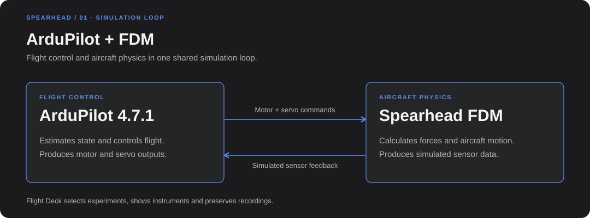
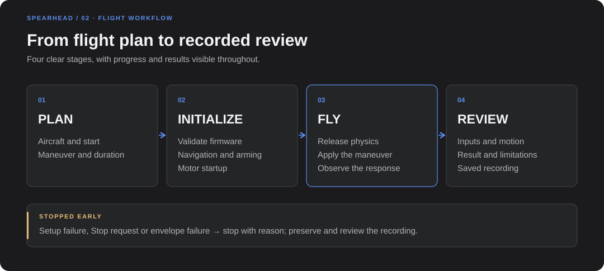

# ArduPilot SITL integration

How the Spearhead flight dynamics model (FDM) runs with the real ArduPlane firmware, which
runners exist and what each run checks. Installation is in the [setup guide](setup_guide.md);
using the browser interface is in the [Flight Deck guide](flight_deck.md).



ArduPilot owns state estimation, arming, flight modes, controllers, motor mixing and servo
outputs. The FDM turns those outputs into forces and moments, integrates the aircraft motion
and returns simulated sensors. The Flight Deck only observes and records the run; opening a
browser does not create a second physics model. Nothing is flashed to hardware.

## Firmware

- Pinned to ArduPlane **Plane-4.7.1**, commit `dbe792162d06cab66c3475fd5556bf7a120f119e`.
  `scripts/build_ardupilot_sitl.sh` clones that tag into `.sitl/ardupilot-4.7.1`, refuses any
  other commit or a modified checkout, builds `waf plane --board sitl` and copies the executable
  to `.sitl/arduplane-4.7.1`.
- Every run checks the executable identity string (`ArduPlane V4.7.1 (dbe79216)`) and records
  its SHA-256. Another binary is refused; a firmware upgrade needs its own compatibility review
  and fresh flight checks.
- Each run gets its own working folder, parameter file, EEPROM and DataFlash logs. Parameters
  are loaded only into that SITL session.

## Protocol and timing

- ArduPilot JSON SITL (`--model JSON:127.0.0.1`). The firmware sends binary servo packets
  (16 or 32 channels); the FDM answers each with one newline-terminated JSON sensor frame.
- Lockstep at 200 Hz from the sensor timestamp, never from wall time. A new frame advances the
  physics one step; a repeated frame gets the same answer without advancing. Stale frames,
  counter restarts, a different peer, NaN/Inf values or a 10 s silence stop the run with an
  error; uint32 counter wrap is handled.
- The advertised firmware frame rate is recorded but does not change the physics step.
- Simulation may run slower than real time. Runners allow five times the simulated time
  including about 60 s of startup (`--wall-timeout` overrides it); only the host deadline
  changes, not physics or controller timing.

## Channels and actuators

| Output | Mapping |
|---|---|
| SERVO1–4 | Virtual aileron, elevator (reversed), pusher, rudder |
| SERVO5–8 | Lift motors 1–4 (Quad-X); FDM rotor order front-right, rear-right, rear-left, front-left = channels 5, 8, 6, 7 |
| Lift PWM | 1100–1940 µs (`Q_M_PWM_MIN/MAX` from the PT1 log) |
| Surface travel | PT1.5: ±30° over 1000–2000 µs (Aero team proposal, uncalibrated); reference fixed-wing configurations: ±20° |

Servo and ESC dynamics are ideal (no delay or rate limit). The two-surface V-tail outputs
(`SERVOn_FUNCTION` 79/80) are not modelled yet; the virtual elevator and rudder channels map
directly to the aerodynamic control increments.

## Sensors

- Position and velocity in NED, gyro and accelerometer in body FRD. The accelerometer reports
  specific force `(F_total − F_gravity)/m`, with the IMU at the CG.
- Airspeed: a pitot reading consistent with the FDM density (1.021 kg/m³), so the firmware's
  airspeed matches the model at the Ankara field altitude.
- Wind (steady plus 1-cosine gusts) acts through the air-relative velocity for aerodynamics,
  pusher inflow and pitot; the state keeps the inertial velocity.
- Lift-pack voltage and current go in the JSON `battery` field (generic LiPo curve, 45 mΩ, lift
  motors plus 1.5 A avionics). The firmware reads it only with `BATT_MONITOR = 4` (SITL analog
  pins 13/12, `BATT_VOLT_MULT` 10.1, `BATT_AMP_PERVLT` 17), which is not yet in the repository
  parameters. Thrust uses nominal pack voltage.
- Home is the Ankara test field: 39.8582, 32.5460, 1125 m above sea level.

## Startup sequence



1. The FDM holds the aircraft stationary while the firmware calibrates the barometer and the
   pitot (zero airspeed), starts EKF3 and gets a GPS fix; home is set and confirmed.
2. Normal arming (`ARMING_REQUIRE 1`, `ARMING_SKIPCHK 0`, `AHRS_EKF_TYPE 3`); no forced arming
   or EKF truth mode. A run is not released without EKF attitude, velocity and position flags.
3. Air starts: motors spool up in the starting mode, then the hold is released on the next
   physics step and the flight clock starts (about 47 simulated seconds after launch). Ground
   starts run free physics on the landing gear from the beginning.
4. After release every actuator command comes from the firmware's PWM. There is no trim
   override or hidden force.

Wind starts at release (ground starts: when the lift motors spin up), so the pitot calibration
sees still air. Injected failures act between the firmware outputs and the physics; the firmware
is not told.

## Runners

All commands run from `src/tools/flight_dynamics_model` with the environment active and
`PYTHONPATH` set to that folder. Each run needs a new `--output` folder; use different
`--port`/`--mavlink-port` values to run several at once.

| Runner | Scenarios | Pass criteria |
|---|---|---|
| `python -m spearhead.sitl.quad` | Hover hold (default); `--doublet pitch_doublet\|roll_doublet\|yaw_doublet\|throttle_doublet`; `--transition` (hover → FBWA) | Hover: full duration, settled tilt RMS < 2°, altitude within 2 m after settling, tilt < 15°, lift PWM 1100–1940 µs. Transition: full duration, confirmed FBWA, and at least 10 s continuous with fresh FBWA heartbeats, airspeed 20–30 m/s, lift at idle, roll/pitch within ±15°, altitude within ±15 m |
| `python -m spearhead.sitl.flight` | PT1.5 forward-trim starts (with a forward-start `--config`): `fbwa`, `back_transition`, `pitch_doublet`, `roll_doublet`, `yaw_doublet`, `throttle_doublet`. Reference-design regression with the default configuration: `manual`, `steps`, `elevator` | Doublets: both input lobes delivered and neutral restored, full duration, attitude envelope; recovery reported separately. Forward → hover: 10 s with fresh QLOITER confirmation, TAS ≤ 2 m/s, vertical speed ≤ 1 m/s, roll/pitch within ±10°, altitude within ±15 m, lift active, pusher off. Steps: settling < 5 s, overshoot < 30 % |
| `python -m spearhead.sitl.ground_flight` | Takeoff → timed hover → landing on gear in AUTO | Normal arm, mission accepted, liftoff, target height, hover dwell, landing on gear, firmware disarm, tilt < 15°, pusher off |
| `python -m spearhead.sitl validate\|smoke\|serve` | Configuration check; 30 s protocol smoke test with the bootstrap hold; backend for an external ground station | `validate` checks data, density and reference center; `smoke` checks firmware version, heartbeat, attitude, GPS and servo telemetry |
| `python -m spearhead.sitl.replay <run>` | Recomputes a finished run from its recorded PWM history without firmware | Position < 0.01 m, velocity < 0.001 m/s, attitude < 0.01° |

Examples:

```sh
python -m spearhead.sitl.quad --binary .sitl/arduplane-4.7.1 --output .sitl/runs/hover-001 --duration 60
python -m spearhead.sitl.quad --doublet roll_doublet --binary .sitl/arduplane-4.7.1 \
  --output .sitl/runs/hover-roll-001 --duration 45
python -m spearhead.sitl.quad --transition \
  --binary .sitl/arduplane-4.7.1 --output .sitl/runs/transition-001 --duration 60
python -m spearhead.sitl.flight pitch_doublet --config my_forward_setup.yaml \
  --forward-parameters first_transition_2026_10_09 \
  --binary .sitl/arduplane-4.7.1 --output .sitl/runs/fw-pitch-001 --duration 45
```

A forward-start configuration is easiest to create from the Flight Deck (the setup is saved
next to each recording) or with `spearhead.gui.flight_setup.FlightSetup(...).config()`.
`scripts/analyse_input_responses.py` turns hover and forward doublet runs into response
metrics and figures.

## Configurations and parameters

| File | Use |
|---|---|
| `sitl_configs/quad_hover.yaml`, `quad_ground.yaml`, `quad_transition.yaml` | PT1.5 air start, ground start and hover → forward; target CG (−0.040, 0, +0.065) m |
| `sitl_configs/quad_hover_controller.json` | VTOL gains as logged on PT1 (frozen) |
| `sitl_configs/plane_4_7_1.parm` | Base parameter file |
| `sitl_configs/fixed_wing_control.yaml`, `fixed_wing_new.yaml`, `elevator_demo.yaml` | Reference-design software regression only: they use a CG 0.45 m below the origin so that ADB v1.1 trims, which is not physical |

Fixed-wing gains come from one frozen set, `first_transition_2026_10_09` (the 9 October
proposal); servo trims are derived from the computed physical trim. The ground start adds
`Q_GUIDED_MODE 1`, `Q_OPTIONS 65536`, `Q_NAVALT_MIN 2`, `Q_WP_SPD_UP 1`, `Q_WP_SPD_DN 1`,
`Q_LAND_FINAL_SPD 0.5` and `TERRAIN_ENABLE 0`. Aligning the SITL parameters with the aircraft
(battery monitor and failsafe, servo ranges, loop rate) is pending approval.

## Recorded files

| File | Content |
|---|---|
| `manifest.json` | Configuration, aircraft and AeroDB identity, source hashes, firmware identity, CG, wind, failure, parameter overlay |
| `truth.jsonl` | FDM state, PWM, controls, sensors, alpha/beta, airspeed, wind, battery and pusher data at 200 Hz |
| `telemetry.jsonl` | MAVLink messages from the firmware |
| `logs/*.BIN` | Firmware DataFlash log |
| `events.json`, `report.json` | Run events and the pass/fail analysis |

A 45 s run is about 50 MB. Recordings stay under `.sitl/`, which Git ignores; curated figures
and metrics for published results go into the information note that uses them.

## Tests

`python -m pytest tests -q` covers the packet formats, duplicate/wrap/restart/peer handling,
actuator ranges, rotor moments, IMU and frame transforms, the stepping integrator against
offline RK4, loopback UDP, runner analyses and the GUI helpers. The tests do not start the
firmware; `smoke` and the runners above do.
